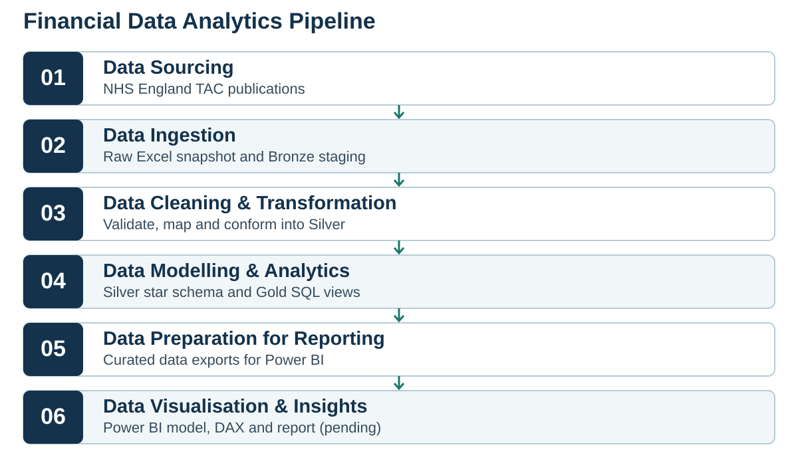

# NHS Trust Financial Analytics — Project Documentation

**Research-led financial analytics | NHS England provider accounts | 2021/22–2023/24**

This document explains the business question, NHS accounting context, implemented data architecture, six-stage processing lifecycle, analytical measures, published-account reconciliation and outstanding validation work. It is written for readers who want to understand **what the project does, why each design choice matters, how to reproduce it and which conclusions remain provisional**.

**Project status (28 October 2026):** The repository contains ingestion, transformation, SQL modelling, validation, export and Power BI modelling assets. The final interactive Power BI dashboard has **not been published**, and the project's historical financial totals have **not yet been independently reconciled** from the raw TAC workbooks to NHS England's consolidated accounts. Code and documentation are evidence of implementation, not proof of a successful fresh execution.

## Contents

This document is organised into three parts, following the research process from **why the investigation was undertaken**, through **how it was conducted**, to **what the findings mean and how the work can be validated**.

### Part I — Background and Research Context

1. [Research question and executive summary](#1-research-question-and-executive-summary)
2. [NHS financial reporting and sustainability](#2-nhs-financial-reporting-and-sustainability)
3. [Objectives, scope and definitions](#3-objectives-scope-and-definitions)

### Part II — Research Methodology

4. [Methodology: Six-stage data analytics lifecycle](#4-methodology-six-stage-data-analytics-lifecycle)

The six stages are explained together within the methodology section, from **Data Sourcing** to **Data Visualisation & Insights**. A stage-by-stage navigation list appears at the beginning of that section.

### Part III — Findings, Validation and Project Outcomes

11. [Financial findings and reconciliation](#11-financial-findings-and-reconciliation)
12. [Data quality, auditability and limitations](#12-data-quality-auditability-and-limitations)
13. [Reproducibility and operational workflow](#13-reproducibility-and-operational-workflow)
14. [Project deliverables and next steps](#14-project-deliverables-and-next-steps)
15. [Glossary and reference material](#15-glossary-and-reference-material)

---

**PART I — BACKGROUND AND RESEARCH CONTEXT**

## 1. Research question and executive summary

### Why I undertook this project

NHS providers operate under persistent pressure to deliver safe and effective services while managing finite public resources. NHS England publishes Trust Accounts Consolidation (TAC) information that can help explain changes in provider income, operating expenditure, staffing costs and financial balances. However, the relevant information is spread across annual workbooks and accounting schedules, making systematic, cross-year exploration difficult without a repeatable analytical process.

I developed this project to connect **financial reporting knowledge, data engineering and business intelligence**. The intention is to make published financial data easier to analyse while retaining the accounting definitions and audit trails needed for trustworthy reporting.

### Research question

> **How is the financial health of NHS Trusts in England changing over time, and which parts of the health system are under the most pressure?**

This question has two parts: the national movement in financial performance, and the distribution of that performance across trusts, provider types and regions. National totals cannot, by themselves, identify the pressures experienced by each organisation or establish the causes of differences.

### What the external evidence currently shows

NHS England's published consolidated provider accounts report a surplus of **£562 million** in 2021/22, a deficit of **£457 million** in 2022/23 and a deficit of **£2.312 billion** in 2023/24, using the **surplus/(deficit) before impairments and transfers** measure. The associated number of providers reporting a deficit increased from **74 of 215** to **105 of 212** and **136 of 211** respectively.

These are **official published benchmarks, not independently reproduced outputs from the project's SQL pipeline**. The project also calculates an **operating** surplus/(deficit), which is a different measure; the earlier figures in project narratives must not be substituted for the official series or used to claim reconciliation. See [Financial reconciliation workpaper](reports/nhs_financial_reconciliation.md).

**Primary sources:** [2021/22 NHS provider accounts](https://www.gov.uk/government/publications/consolidated-nhs-provider-accounts-2021-to-2022), [2022/23 accounts](https://www.gov.uk/government/publications/consolidated-nhs-provider-accounts-2022-to-2023), [2023/24 accounts](https://www.gov.uk/government/publications/consolidated-nhs-provider-accounts-2023-to-2024).

### Analytical approach

The project uses Python to ingest and process NHS England TAC workbooks, MySQL to store and organise financial records, SQL to derive analytical views and KPIs, CSV exports to prepare curated reporting data, and Power BI/DAX assets to specify interactive reporting. Source accounting codes remain essential throughout: a polished chart is not an adequate substitute for a correctly defined financial measure.

---

## 2. NHS financial reporting and sustainability

### NHS providers and their financial context

NHS trusts and NHS foundation trusts deliver healthcare services within England's publicly funded health system. Provider activity includes acute, specialist, mental health, community and ambulance services; sector labels in source workbooks must be respected rather than inferred from a provider's name. Provider income, funding arrangements, patient-care costs and accounting treatment can vary, so benchmarking needs appropriate context.

NHS Trust Accounts Consolidation records include the **Statement of Comprehensive Income (SoCI)**, balance-sheet information and schedules for patient-care income, expenses and workforce. TAC is useful for consistent accounting analysis; it is not a substitute for operational, workforce-quality or clinical outcomes data.

### What financial sustainability means

For this project, financial sustainability means the capacity to meet obligations, manage resources and maintain safe healthcare delivery over time. **Covering annual costs is important but not sufficient**: liquidity, financial plans, cost pressures, productivity, capital commitments and continuity of patient services also matter.

The project evaluates complementary measures:

| Measure | Interpretation | Important qualification |
| --- | --- | --- |
| Operating surplus/(deficit) | Operating income less operating expenses | TAC `SCI0140A` in the current SQL; not the published adjusted balance |
| Before-impairments-and-transfers financial balance | NHS England's published provider financial comparison basis | Requires accounting reconciliation and consolidation adjustments |
| Net surplus/(deficit) | Bottom-line accounting result | Not necessarily the same as NHS England's published performance measure |
| EBITDA margin | Project-calculated operating result plus depreciation/amortisation, relative to income | Supplementary ratio; not cash flow or a regulatory pass/fail test |
| Pay as a percentage of income | Share of operating income used on workforce costs | Depends on consistent classification of staff and agency costs |
| Cost per WTE | Staff costs divided by average whole-time equivalent employees | Highly sensitive to workforce composition and cost definition |

**Regulatory distinction:** There is no substantiated NHS-wide rule in this repository that an EBITDA margin of 2% establishes financial sustainability or that a negative EBITDA margin automatically triggers regulatory intervention. NHS England uses a wider [oversight framework](https://www.england.nhs.uk/nhs-oversight-framework/) covering financial performance and other domains. Any RAG thresholds in this project are **illustrative, project-defined analytical bands** unless a separately cited official rule applies.

### Accounting comparability across years

Account balances can change because of service pressures **and** accounting policies. For example, NHS England reports that 2023/24 treatment of PFI and other service-concession liabilities under IFRS 16 increased the reported deficit by approximately **£1.094 billion**. The impact should be explained when discussing trends; it must not be applied automatically to an individual trust's unrelated operating measure.

---

## 3. Objectives, scope and definitions

The objectives are to:

1. **Source and consolidate data** from published NHS Trust and Foundation Trust TAC workbooks for the three financial years, recording source versions and the actual population by year.
2. **Develop a reusable pipeline** for extraction, loading, data checks and repeatable transformation, with idempotence demonstrated by explicit reload tests rather than assumed.
3. **Calculate consistent financial indicators** and distinguish operating, net and adjusted balances.
4. **Reconcile relevant measures** to NHS England's published accounts, documenting consolidation adjustments and unexplained variances rather than forcing agreement.
5. **Keep calculations auditable** through source file, reporting year, trust identifier, worksheet, SubCode, data checks and transformation rules.
6. **Support financial interpretation and accessible reporting** through analytical SQL and a Power BI model, with dashboard publication as a pending deliverable.

### Scope

| Dimension | Definition |
| --- | --- |
| Reporting periods | 2021/22, 2022/23 and 2023/24 |
| Primary source | NHS England TAC workbooks: NHS trusts and foundation trusts for each year |
| Source format | Excel, provider roster and long-form TAC accounting records |
| Analytical grain | Primarily organisation × financial year, with source-level SubCode detail |
| Main technologies | Python, pandas, SQLAlchemy, MySQL, SQL, CSV and Power BI/DAX |
| Exclusions | No causal demonstration of why a trust entered deficit; no published dashboard at present |
| Population note | Do **not** assume a constant 206 trusts: reported counts differ by year and require source-level reconciliation |

The warehouse may contain more organisational identifiers than a year-specific analytical view because of trust changes, merging, source omissions or filtering. An apparent count mismatch must be investigated before making national comparisons.

---

**PART II — RESEARCH METHODOLOGY**

## 4. Methodology: Six-stage data analytics lifecycle

### Methodology roadmap

The methodology is organised as six consecutive stages. Select a stage to go directly to its technical explanation:

1. [Data Sourcing](#5-stage-1--data-sourcing) — obtain authoritative NHS England TAC data and define source controls.
2. [Data Ingestion](#6-stage-2--data-ingestion) — capture source workbooks and load raw records to Bronze.
3. [Data Cleaning & Transformation](#7-stage-3--data-cleaning--transformation) — standardise, validate and conform records in Silver.
4. [Data Modelling & Analytics](#8-stage-4--data-modelling--analytics) — organise dimensions, facts and financial KPIs in Silver and Gold.
5. [Data Preparation for Reporting](#9-stage-5--data-preparation-for-reporting) — prepare curated datasets and exports.
6. [Data Visualisation & Insights](#10-stage-6--data-visualisation--insights) — design and communicate Power BI financial analysis.

The project is explained using stages named for **the work performed**, not merely the software or storage location.



| Stage | Purpose | Main assets / implementation |
| --- | --- | --- |
| **1. Data Sourcing** | Identify authoritative data, accounting definitions and versions | NHS England TAC publications; source registers |
| **2. Data Ingestion** | Preserve source snapshots and land source records | `data/raw/`, Python ingestion, MySQL Bronze |
| **3. Data Cleaning & Transformation** | Standardise, validate and conform accounting data | Python transformation/validation, MySQL Silver |
| **4. Data Modelling & Analytics** | Build analytical relationships, reporting views and KPIs | Silver star schema, Gold views, analytical SQL |
| **5. Data Preparation for Reporting** | Supply curated tables in usable reporting form | CSV exports from Gold/Silver for Power BI |
| **6. Data Visualisation & Insights** | Communicate financial results and explore variations | Power BI model design, DAX definitions; report pending |

**Technical architecture:** `nhs_bronze` is the raw landing area, `nhs_silver` contains conformed provider and TAC records, and `nhs_gold` exposes analytical reporting views. The stages overlap these storage layers: landing into Bronze is ingestion; transformation into Silver follows; Gold views are built for analysis and then exported for reporting.

The [original detailed technical architecture diagram](docs/images/pipeline_architecture.png) is retained alongside the lifecycle visual.

---

## 5. Stage 1 — Data Sourcing

**Purpose:** Establish the provenance, reporting scope and accounting context of every input.

NHS England publishes TAC information as annual workbooks. This project was designed around two datasets for each of three reporting years—one NHS trust workbook and one foundation trust workbook—giving **six expected source files**. Source files must be downloaded from the official publication rather than treated as permanently reproducible merely because a filename is known.

Expected local naming pattern:

```text
data/raw/TAC_NHS_trusts_2021-22.xlsx
data/raw/TAC_NHS_foundation_trusts_2021-22.xlsx
data/raw/TAC_NHS_trusts_2022-23.xlsx
data/raw/TAC_NHS_foundation_trusts_2022-23.xlsx
data/raw/TAC_NHS_trusts_2023-24.xlsx
data/raw/TAC_NHS_foundation_trusts_2023-24.xlsx
```

### Source selection and control

For each workbook, record: the issuing organisation, exact page URL, file version and download date, filename, checksum, financial year, trust type, provider count, currency units and sign convention. These are **required reproducibility controls**, not all fully evidenced as completed in the current repository.

The provider roster supplies organisation identifiers and descriptive metadata such as sector and region. The `All data` sheet includes long-form financial entries: organisation name, worksheet, main code, SubCode and amount. Different annual templates may use slightly different column names.

**Reference:** [Stage 1 technical note](notebook/stage_01_nhs_england_source.md) and [TAC source publication](https://www.england.nhs.uk/financial-accounting-reporting-systems/nhs-england-finance-returns-publications-guidance/trust-accounts-consolidation-tac/).

**Output of this stage:** A documented, versioned source dataset and a justified accounting population.

---

## 6. Stage 2 — Data Ingestion

**Purpose:** Load identifiable source records without losing their origin.

The raw workbooks reside in `data/raw/` and are excluded from Git due to size and licensing/republication considerations. The implemented script `python/ingestion/load_tac_data.py` reads provider rosters and `All data` schedules, normalises column headings, parses a financial-year token from filenames and assigns a trust type from the filename.

### Bronze landing

The ingestion process writes to MySQL `nhs_bronze.stg_provider_list` and `nhs_bronze.stg_tac_raw`. These staging datasets preserve source file, trust type, financial year, reporting codes and source amounts. For a given year/type pair the script deletes existing staging rows before appending a replacement batch; this is a design for controlled reloads, **not proof of end-to-end idempotence** once Silver dimensions and facts are considered.

Simplified flow:

```text
NHS England TAC workbook
    -> Python Excel reader / schema normalisation
    -> provider list + long-form accounting records
    -> MySQL Bronze staging
```

### Ingestion controls to verify

- Verify that each expected workbook exists, has the required sheets and uses the expected accounting units.
- Ensure row-count and provider-count changes are visible rather than silently accepted.
- Check duplicates using a business key that includes all required TAC dimensions.
- Check whether the script's `MainCode` logic correctly distinguishes current-year from prior-year fields in every version.
- Ensure organisation-name matching cannot assign the wrong ODS code because of spelling changes, mergers or duplicate names.
- Validate that an interrupted load does not leave one year/type incomplete.

The current ingestion script has been changed to read a MySQL password from the environment; **other scripts have not all been updated to the same standard** (see Section 12).

**Reference:** [Stage 2 technical note](notebook/stage_02_raw_excel_files.md), [ingestion script](python/ingestion/load_tac_data.py).

**Output:** A traceable Bronze landing of each selected source workbook.

---

## 7. Stage 3 — Data Cleaning & Transformation

**Purpose:** Convert raw financial records into consistent, analysable data while preserving an audit path.

The repository contains `python/transformation/transform_tac_data.py` and `python/transformation/validate_tac_data.py`, in addition to transformation logic performed during ingestion and promotion to MySQL Silver. These pieces must be understood as a connected workflow, not as one single cleaning function.

### Core transformation responsibilities

| Activity | Why it matters |
| --- | --- |
| Standardise schema and text fields | Different annual workbooks may label equivalent fields differently |
| Identify financial year and reporting type | Avoid mixing current-year values with prior-year comparatives |
| Standardise provider IDs | Enable longitudinal trust analysis through ODS codes |
| Preserve worksheet and SubCode | Keep accounting meaning attached to every amount |
| Check nulls and duplicates | Prevent missing amounts and double-counting |
| Respect source signs and monetary units | Avoid false surplus, deficit or percentage results |
| Validate dimensions and facts | Ensure provider/year joins do not create lost or duplicated rows |

### Silver conformed data

The principal conformed objects are `nhs_silver.dim_trust` and `nhs_silver.fct_tac`. The fact table is intentionally in long format: each accounting amount remains keyed by its code, financial year and organisation instead of being permanently flattened into many columns. Later views convert selected SubCodes into analytical measures.

A critical design issue is **year-specific provider membership**. A single dimension of all trusts ever seen must not replace a validated annual provider roster when calculating the number or percentage of trusts in deficit.

### Validation and handling exceptions

The repository contains a validation script and `sql/views/v_validation_checks.sql`; the Python script writes a validation report to `data/processed/validation_report.csv`. Some thresholds in the validation script are expected ranges—not independently verified national accounting totals. Record the check name, severity, reporting year, observed result, expected basis and action taken.

For national-level reconciliation, validation must be stronger than checking whether totals fall inside broad tolerances. Require explicit accounting and population matches or explain their remaining differences.

**Reference:** [Stage 3 technical note](notebook/stage_03_mysql_staging.md), [transformation](python/transformation/transform_tac_data.py), [validation](python/transformation/validate_tac_data.py).

**Output:** Cleaned and conformed Silver financial records with a documented exception trail.

---

## 8. Stage 4 — Data Modelling & Analytics

**Purpose:** Turn verified accounting records into consistent analysis-ready measures and comparisons.

### Star-schema structure

The Silver layer separates provider attributes in `dim_trust` from long-form TAC entries in `fct_tac`. The Gold layer provides views that pivot selected codes into organisational annual summaries. Keep the annual grain explicit and check uniqueness of trust × financial year before joining separate reporting views.

Principal SQL assets:

| View | Business use |
| --- | --- |
| `v_income_expenditure` | Operating income, expenditure, operating and net results |
| `v_expenditure_breakdown` | Pay, non-pay and selected cost categories |
| `v_workforce` | Whole-time equivalent workforce and staff cost measures |
| `v_profit_and_loss` | Detailed statement of comprehensive income |
| `v_balance_sheet` | Balance-sheet measures |
| `v_kpis` | Derived annual financial indicators and project RAG bands |
| `v_trust_annual_scorecard` | Combined provider/year reporting table |
| `v_validation_checks` | Database-level diagnostic checks |

For actual SQL definitions, use the files under [sql/views](sql/views/), not a copied query in a narrative. Financial subcode descriptions are documented in [data dictionary](agent_docs/data_dictionary.md).

### Accounting measure mapping

`v_income_expenditure.sql` currently maps:

```sql
-- Source amounts are in £000s.
SCI0100A -> patient_care_income_000s
SCI0110A -> other_income_000s
SCI0125A -> operating expenditure (made positive with ABS)
SCI0140A -> operating_surplus_000s
SCI0240  -> net_surplus_000s
```

These are the project's existing mappings. **They have not all been verified against the relevant source workbook schedules in the current review**. In particular, `SCI0140A` is not NHS England's published consolidated before-impairments-and-transfers result.

### KPI formulas and interpretation

| KPI | Implemented analytical formula | Interpretation / caution |
| --- | --- | --- |
| EBITDA (£000s) | Operating surplus + depreciation and amortisation | Verify the additive sign of depreciation/amortisation and source coverage |
| EBITDA margin (%) | EBITDA ÷ total operating income × 100 | Supplementary indicator, not the official provider deficit |
| Pay as % of income | Pay costs ÷ income × 100 | Verify agency/non-pay classification |
| Cost per WTE | Staff costs (£000s) ÷ average WTE | Compare only with relevant staff mix and period |
| Net surplus margin (%) | Net surplus ÷ income × 100 | Different from the published adjusted financial balance |

The project's EBITDA RAG bands are **Green ≥5%**, **Amber ≥2% and <5%**, and **Red <2%**. These are **illustrative project categories**, not official NHS England regulatory thresholds. The current SQL implementation was updated to correct the calculation's operator precedence and to reuse the KPI RAG classification in the annual scorecard. Those revisions still require a database execution test.

Likewise, the scorecard's `is_deficit` flag reflects the operating-result definition; it **must not** be presented as the official published count of providers in deficit.

### Analysis questions supported

- How did operating income and expenditure change over time?
- How do the shares of pay, drugs and other costs vary by service sector?
- Which providers have consistently negative operating results or unusually high expenditure?
- How does net financial performance vary across regions or provider types?
- Where do the provider-level figures diverge from published national totals, and why?

Investigate population changes and accounting adjustments before interpreting trend movements as operational causes.

**References:** [Stage 4 technical note](notebook/stage_04_mysql_analytics.md), [KPI definitions](agent_docs/kpi_definitions.md), [sector trend SQL](sql/analysis/sector_trend_analysis.sql), [benchmarking SQL](sql/analysis/benchmarking_analysis.sql).

**Output:** SQL financial views, documented KPI logic and a trust-level analytical scorecard awaiting full reconciliation.

---

## 9. Stage 5 — Data Preparation for Reporting

**Purpose:** Shape curated, analysable database outputs for a reporting tool without redefining the underlying accounting logic.

The script `python/reporting/export_for_powerbi.py` exports dimensions, summary views, detailed financial categories and calculated KPIs into `data/processed/powerbi_export/`. The intended consumption pattern is **MySQL views → CSV → Power BI Import model**. The repository also contains a model and DAX guidance for connecting these files.

Representative outputs include:

```text
dim_trust.csv
dim_financial_year.csv
ie_summary.csv
expenditure_breakdown.csv
workforce.csv
kpis.csv
income_detail.csv
expenditure_detail.csv
profit_and_loss.csv
balance_sheet.csv
sector_benchmarks.csv
```

The exact set generated by a given run must be confirmed against the export script and execution logs. The setup guide contains illustrative or previously observed row counts; these should not be used as validation evidence without a fresh export.

### Reporting data checks

Before loading Power BI:

1. Confirm every expected CSV exists and has the intended column names and data types.
2. Check financial-year and ODS-key coverage and uniqueness at each table's intended grain.
3. Reconcile key totals from each CSV to its originating SQL view.
4. Confirm currency units remain £000s and percentages are not inadvertently summed or re-scaled.
5. Check that dimensional relationships cannot produce many-to-many inflation of totals.
6. Version the export and record the corresponding source workbook set.

A row-per-trust/year table should not be joined directly to another fact table as though it were a lookup dimension. Model relationships through appropriate trust/year dimensions and validate filter propagation.

**References:** [Stage 5 technical note](notebook/stage_05_csv_exports.md), [export script](python/reporting/export_for_powerbi.py), [Power BI setup guide](power_bi/setup_guide.md).

**Output:** Curated financial datasets suitable for a reviewed reporting model.

---

## 10. Stage 6 — Data Visualisation & Insights

**Purpose:** Make reconciled financial information interpretable by a finance director, board member or analyst.

The repository contains [Power BI setup instructions](power_bi/setup_guide.md), [DAX measures](power_bi/dax_measures.md) and a model-measure definition file [`_Measures.tmdl`](power_bi/dax/_Measures.tmdl). **A published, verifiable Power BI report and genuine dashboard screenshot are not currently provided.** The pages below describe the intended reporting design, not a claimed deployed dashboard.

| Proposed report page | Central questions |
| --- | --- |
| Executive financial summary | How are official and operational balances changing, and are they reconciled? |
| Income and expenditure | How fast are income and expenditure changing, and by service sector? |
| Cost pressures | What proportion of income is used by pay, drugs and other costs? |
| Trust comparison | Which organisations differ on comparable, validated financial measures? |
| Workforce | How do staffing levels and costs affect relative financial performance? |

### Presentation standards

A trustworthy dashboard should label the accounting basis, reporting year, provider population, units and KPI calculation. Display **operating** and **published adjusted** results as separate measures. Link supporting measures to source/definition notes. Do not show project-defined Red/Amber/Green labels as NHS regulatory assessments.

The primary executive page should provide a clear summary but avoid making unsupported claims of causation. Changes in accounting policy, population composition or source completeness can alter financial comparisons without corresponding changes in service quality.

**References:** [Stage 6 technical note](notebook/stage_06_powerbi_dashboard.md), [Power BI setup guide](power_bi/setup_guide.md), [DAX measures](power_bi/dax_measures.md).

**Status:** Model and report specification present; publication and end-to-end data validation remain pending.

---

**PART III — FINDINGS, VALIDATION AND PROJECT OUTCOMES**

## 11. Financial findings and reconciliation

### Published national benchmarks

The authoritative external benchmarks for this period, based on the NHS England definition **before impairments and transfers**, are:

| Reporting year | Published balance | Official deficit providers | Deficit share |
| --- | ---: | ---: | ---: |
| 2021/22 | +£562m | 74 of 215 | 34.4% |
| 2022/23 | −£457m | 105 of 212 | 49.5% |
| 2023/24 | −£2,312m | 136 of 211 | 64.5% |

*These are official NHS England observations, not independently reproduced project results.* The trend indicates deterioration in the reported balance, but the accounting-policy changes and below-operating items require care in attributing its causes.

### Why the old project headline does not reconcile

Previous versions of the project reported operating results of approximately **+£1.6bn**, **+£148m** and **−£1.6bn** over the same period and counted 37, 85 and 124 trusts in operating deficit. Those figures were not independently reproduced during this documentation review. They reflect a **different measure and potentially a different population** from the published series. A subtraction of one from the other is a diagnostic gap, not an explained accounting reconciliation.

The [financial reconciliation workpaper](reports/nhs_financial_reconciliation.md) records the preliminary comparison, a verified published 2022/23 accounting bridge, relevant code issues, diagnostic SQL, and tasks required to complete the work.

### Requirements for completing the reconciliation

- Re-obtain the exact six official workbooks and validate their contents and provider rosters.
- Generate per-trust/year output for `SCI0140A`, `SCI0240` and relevant below-operating items.
- Trace the official before-impairments-and-transfers measure through published accounts and reporting definitions.
- Reconstruct appropriate inter-provider and charity-related consolidation adjustments from the official accounts where necessary.
- Align the definition and population used for counting trusts in deficit.
- Explain the 2023/24 IFRS 16/PFI comparability effect.
- Produce a signed-off variance bridge by financial year with material differences explained.
- Regenerate reporting exports and Power BI results from validated rather than merely plausible totals.

No number should be changed solely to match an external benchmark. Unresolved differences should remain visible until their accounting or data cause is known.

---

## 12. Data quality, auditability and limitations

### Controls that make the project credible

**Source traceability:** The chain should retain source filename → provider/ODS code → year → worksheet → SubCode → raw amount → transformation → analytical KPI. Store an import identifier, checksum and exceptions alongside the actual results where available.

**Completeness:** Check that both trust types and each annual file are represented. A dimension containing 215 provider IDs does not mean all 215 are active and present in every annual analysis.

**Uniqueness:** Check source keys and annual trust rows separately; careless pivoting with `MAX(CASE ...)` can conceal duplicate source records rather than resolve them.

**Accounting validity:** Validate the sign of expenses, the unit of amounts, below-operating charges, impairments/transfers and consolidation adjustments. Similar-sounding surplus measures are not necessarily comparable.

**Statistical interpretation:** A higher spending percentage or a negative margin can identify areas for investigation but is not proof of inefficiency, poor management or reduced service quality.

### Implementation and security issues requiring follow-up

| Observation | Impact | Status |
| --- | --- | --- |
| The official-balance measure is not yet reconciled to project-generated outputs | Published and model-derived figures must not be combined as if equivalent | Open |
| Operating-based `is_deficit` differs from official before-impairments-and-transfers classification | Incorrect comparison of deficit counts | Open |
| Provider population may be filtered by positive income or altered by source coverage | Year-on-year denominators may not match NHS England | Open |
| `MAX(CASE...)` pivots need duplicate-key verification | May mask source duplication or incorrect record selection | Open |
| Validation and reporting/export Python scripts still include hard-coded MySQL credentials | Security exposure; inconsistent environment setup | Open |
| Local source files and populated database were unavailable for a fresh independent run in this review | Results cannot be marked fully reproduced | Open |
| Dashboard is not published | No user-facing interactive report to validate | Open |

**Credential guidance:** `load_tac_data.py` now expects an environment-supplied `DB_PASSWORD`, but `python/transformation/validate_tac_data.py` and `python/reporting/export_for_powerbi.py` still need the same refactor. Never commit real passwords; rotate a password that has already been exposed in Git history. Changes to application code and history must be handled separately and reviewed.

### Meaning of validation in this project

A *passed automated check* means its specified rule passed during that run. It does **not** independently establish that every accounting field is correct or that published NHS balances have been reproduced. Final sign-off requires row-level/source-level evidence and a transparent reconciliation bridge.

---

## 13. Reproducibility and operational workflow

### Prerequisites

- Supported Python installation and dependencies from the repository environment/requirements files.
- A locally available MySQL server with sufficient disk capacity for the TAC extracts.
- Source TAC workbooks obtained from NHS England for the specified financial years.
- Appropriate environment-based database credentials.
- Power BI Desktop for the downstream reporting model, if using the planned dashboard workflow.

### Intended sequence

```text
1. Obtain and register source workbooks (Stage 1).
2. Load source sheets into MySQL Bronze (Stage 2).
3. Transform, map and validate Bronze -> Silver (Stage 3).
4. Create Gold views and validate KPI/grain definitions (Stage 4).
5. Export reviewed model tables into reporting CSVs (Stage 5).
6. Import and validate in Power BI; develop final reports (Stage 6).
7. Reconcile all published-account comparators before releasing final financial findings.
```

Illustrative entry points:

```bash
# Execute from the repository root after configuring a secure local database.
# Check the SQL schema creation and migration instructions before loading.
python python/ingestion/load_tac_data.py
python python/transformation/validate_tac_data.py
python python/reporting/export_for_powerbi.py
```

This is **not a complete one-command reproducibility guarantee**: the SQL schema, views, source files, local environment and unresolved credential inconsistencies must be addressed first. Do not run the last two scripts with historical hard-coded passwords; refactor them to environment variables and rotate exposed credentials.

The SQL views under `sql/views/` and schema scripts under `sql/schema/` must be applied in dependency order. The extensive `create_tables_mysql.sql` includes database objects and must be reviewed for destructive `DROP` operations before running against any valued database. The project should eventually offer a versioned setup script and automated integration test that confirm schema, ingestion, uniqueness, financial mapping, export consistency and replay behaviour.

### Outputs to retain for an auditable run

A reproducible run should archive checksums of six TAC inputs, schema/script revision, Python environment metadata, row counts, provider/year coverage, validation report, exported reporting tables and a signed-off financial reconciliation summary.

---

## 14. Project deliverables and next steps

| Deliverable | Repository evidence | Status |
| --- | --- | --- |
| Source discovery and file conventions | Stage 1–2 notes, ingestion script | Documented; source snapshot not bundled |
| Python data ingestion and transformation | `python/ingestion/`, `python/transformation/` | Code exists; fresh run not verified |
| Bronze/Silver/Gold MySQL architecture | `sql/schema/`, `sql/views/` | Code exists; end-to-end database validation pending |
| Financial analytical SQL and KPIs | `sql/analysis/`, `v_kpis.sql` | Implemented definitions; accounting sign-off pending |
| Financial reconciliation workpaper | [Reconciliation report](reports/nhs_financial_reconciliation.md) | Preliminary; final numerical bridge pending |
| Curated export process | [Power BI export script](python/reporting/export_for_powerbi.py) | Implemented; current export run not verified |
| Power BI modelling and DAX design | `power_bi/` | Design assets provided; published dashboard pending |
| Full reproducible validated case study | Source-to-report run, reconciled results, verified dashboard | Outstanding |

### Recommended order of completion

1. Remove remaining embedded credentials and standardise database configuration.
2. Reconcile source provider populations, TAC accounting codes and national financial balances.
3. Execute automated validation and fresh end-to-end pipeline runs, including duplicate/reload tests.
4. Recalculate financial analysis and amend the detailed [2023/24 review](reports/nhs_sector_financial_review_2324.md) where required.
5. Produce and test a genuine Power BI report with reconciled values, then add screenshots and publication details.
6. Update the concise [README](README.md) with the final independently validated findings.

### What the project demonstrates

Even in its current state, the repository demonstrates a coherent approach to handling public-sector financial datasets: source identification, repeatable ingestion, dimensional modelling, accounting-coded SQL, data validation, KPI specification and reporting design. The unfinished reconciliation and reporting work is explicitly disclosed rather than presented as completed impact.

---

## 15. Glossary and reference material

| Term | Meaning |
| --- | --- |
| NHS Trust / Foundation Trust | NHS provider organisations, with different legal/accountability arrangements |
| TAC | Trust Accounts Consolidation, NHS England's annual provider financial reporting dataset |
| SoCI | Statement of Comprehensive Income |
| ODS code | Organisational identifier used to distinguish providers |
| SubCode | TAC accounting line identifier used to interpret an amount |
| CY / PY | Current-year / prior-year comparative fields |
| WTE | Whole-Time Equivalent workforce measure |
| PDC dividend | Public Dividend Capital-related finance charge |
| EBITDA | Earnings before interest, tax, depreciation and amortisation |
| RAG | Red/Amber/Green analytical classification; not automatically an NHS regulatory rating |
| Bronze / Silver / Gold | Raw landing / conformed data / curated analytical presentation layers |
| Reconciliation | Explaining the bridge between defined accounting measures and published statements |

### Primary references

- [NHS England TAC publications](https://www.england.nhs.uk/financial-accounting-reporting-systems/nhs-england-finance-returns-publications-guidance/trust-accounts-consolidation-tac/)
- [NHS provider consolidated accounts 2021/22](https://www.gov.uk/government/publications/consolidated-nhs-provider-accounts-2021-to-2022)
- [NHS provider consolidated accounts 2022/23](https://www.gov.uk/government/publications/consolidated-nhs-provider-accounts-2022-to-2023)
- [NHS provider consolidated accounts 2023/24](https://www.gov.uk/government/publications/consolidated-nhs-provider-accounts-2023-to-2024)
- [NHS England Oversight Framework](https://www.england.nhs.uk/nhs-oversight-framework/)

### Repository technical references

- [Financial reconciliation and accounting bridge](reports/nhs_financial_reconciliation.md)
- [Financial review and earlier analytical findings](reports/nhs_sector_financial_review_2324.md) — **requires reconciliation review**
- [TAC SubCode data dictionary](agent_docs/data_dictionary.md)
- [KPI definitions and project thresholds](agent_docs/kpi_definitions.md)
- [SQL views](sql/views/) and [analysis SQL](sql/analysis/)
- [Python ingestion, transformation and export](python/)
- [Power BI model guide](power_bi/setup_guide.md) and [DAX](power_bi/dax_measures.md)
- [Original full project documentation archive](docs/project-documentation-history-20261028.md)

---

*This document is a transparent technical and financial research record. The published-account comparison and individual provider findings should be described as fully validated only after completing the pending source-data reconciliation and reproducibility checks.*
