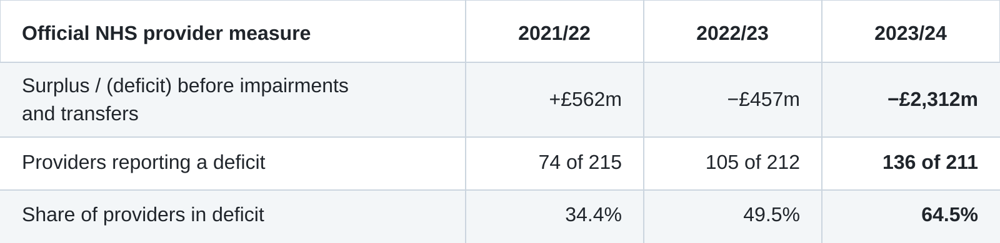
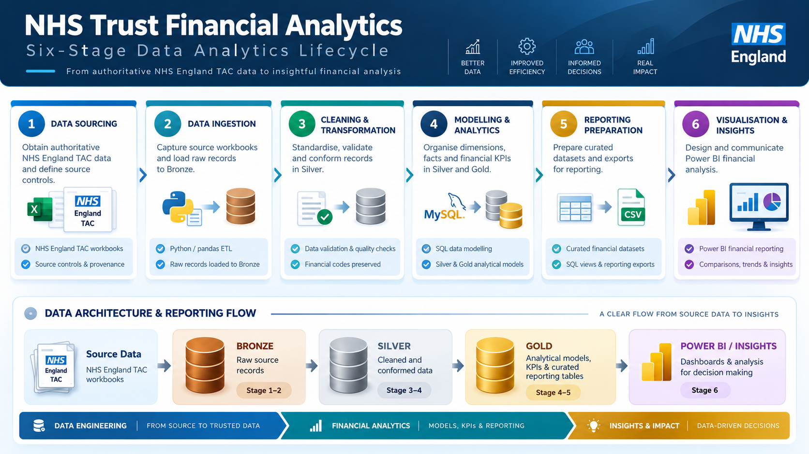

# NHS Trust Financial Analytics

This project was motivated by a need to understand the growing financial pressures facing NHS Trusts in England and identify what the published accounts reveal about their sustainability. I used NHS England's Trust Accounts Consolidation data, alongside Python, MySQL and financial analytics techniques, to investigate how financial performance changed across three reporting years.

## The research question

> **How is the financial health of NHS Trusts in England changing over time, and which parts of the health system are under the most pressure?**

**What the published accounts show:** NHS England reported a £562 million surplus in 2021/22, a £457 million deficit in 2022/23 and a £2.312 billion deficit in 2023/24, measured before impairments and transfers. The proportion of providers reporting a deficit increased from about 34% to 64%. These figures show a worsening financial position but do not, on their own, identify the cause.

**How I investigated it:** I used NHS England's published Trust Accounts Consolidation data for three financial years, processed and standardised the source records with Python, and developed MySQL analytical views and financial measures for cross-year and trust-level comparison. The project also includes a Power BI reporting model; the dashboard itself is pending publication.

[Explore the full project methodology and documentation](project_documentation.md).

## Key findings

View the findings as a text table

<table width="100%">
  <thead><tr><th align="left" width="49%">Official NHS provider measure</th><th align="right" width="17%">2021/22</th><th align="right" width="17%">2022/23</th><th align="right" width="17%">2023/24</th></tr></thead>
  <tbody>
    <tr><td>Surplus / (deficit) before impairments and transfers</td><td align="right">+£562m</td><td align="right">−£457m</td><td align="right"><strong>−£2,312m</strong></td></tr>
    <tr><td>Providers reporting a deficit</td><td align="right">74 of 215</td><td align="right">105 of 212</td><td align="right"><strong>136 of 211</strong></td></tr>
    <tr><td>Share of providers in deficit</td><td align="right">34.4%</td><td align="right">49.5%</td><td align="right"><strong>64.5%</strong></td></tr>
  </tbody>
</table>

**Why it matters:** The figures reveal a widening financial sustainability challenge and make it important to investigate which providers and spending categories face the greatest pressure. They do not, by themselves, establish a single cause of the deterioration.

**Basis and limitations:** The figures above come from NHS England's official consolidated provider accounts, not the project's SQL measure. The pipeline checks its source, grain and provider mapping on every load (the quality gate in `load_tac_data.py`), and `validate_tac_data.py` re-checks grain, coverage and the three-statement reconciliation after each load. However, the TAC-derived operating measure (`SCI0140A`) is different from the official before-impairments-and-transfers balance and still requires a like-for-like accounting bridge. Four SoFP-to-SoCF closing-cash differences above £1k have been traced to bank overdrafts, which the balance sheet and cash-flow statement treat differently by design; with overdrafts added back, all three statements agree for every trust-year.

The 2023/24 deficit includes a £1.094 billion impact from changes in the accounting treatment of PFI liabilities under IFRS 16, affecting comparability.

**Official accounts:** [2021/22](https://www.gov.uk/government/publications/consolidated-nhs-provider-accounts-2021-to-2022) | [2022/23](https://www.gov.uk/government/publications/consolidated-nhs-provider-accounts-2022-to-2023) | [2023/24](https://www.gov.uk/government/publications/consolidated-nhs-provider-accounts-2023-to-2024).

See [Project Documentation](project_documentation.md) and the [2023/24 Financial Review](reports/nhs_sector_financial_review_2324.md) for the existing project calculations, which require review.

[Financial reconciliation workpaper](reports/nhs_financial_reconciliation.md) documents the official accounting bridge, differences in existing SQL metrics and outstanding validation steps.

## Power BI dashboard

**Dashboard publication pending.** The repository includes the Power BI model reference, report page specifications and DAX measure definitions, but no published report or report-page screenshot is available to link here yet.

The report design covers an executive summary, income and expenditure, cost pressures, trust benchmarking and workforce analysis. A genuine dashboard screenshot and verified report link will be added after publication.

[Power BI setup guide](power_bi/setup_guide.md) | [DAX measures](power_bi/dax_measures.md)

## SQL analysis: board questions

The [analysis layer](analysis/README.md) answers the questions a trust board or finance director asks of
the accounts, in SQL. Three query files in [`sql/analysis/`](sql/analysis/) each take one question: where the
financial pressure sits by sector, which cost lines drive the deficits, and how one trust compares with its
peers. The queries use window functions (`LAG`, `RANK`, `NTILE`, `PERCENT_RANK`), `WITH ROLLUP`, medians
built from `ROW_NUMBER()`, pivots straight out of the long fact table, and a profit bridge whose steps reconcile
exactly to the change in the result. No query names a year or a trust.

A notebook per question shows each query next to its result, so the SQL can be read on GitHub without a
database.

[Analysis README](analysis/README.md) | [01 Financial pressure](analysis/notebooks/01_financial_pressure.ipynb) | [02 Cost drivers](analysis/notebooks/02_cost_drivers.ipynb) | [03 Peer benchmarking](analysis/notebooks/03_peer_benchmarking.ipynb)

## Data architecture

### Six-stage data analytics lifecycle

The diagram connects the six methodological stages to NHS England TAC source data, Bronze raw records, Silver conformed financial records, Gold analytical models and the Power BI reporting layer. The dashboard is not yet published.

Explore the six stages and their implementation notes:

- **[Data Sourcing](notebook/01_data_sourcing/README.md):** Obtain NHS England TAC workbooks and establish source controls.
- **[Data Ingestion](notebook/02_data_ingestion/README.md):** Find the TAC workbooks and read their two sheets: the shape of the data before any cleaning.
- **[Data Cleaning &amp; Transformation](notebook/03_data_cleaning_and_transformation/README.md):** Standardise and validate the records, then land them in the Bronze layer.
- **[Data Modelling &amp; Analytics](notebook/04_data_modelling_and_analytics/README.md):** Build SQL dimensions, facts and financial KPIs in Silver and Gold.
- **[Data Preparation for Reporting](notebook/05_data_preparation_for_reporting/README.md):** Create curated datasets and reporting exports.
- **[Data Visualisation &amp; Insights](notebook/06_data_visualisation_and_insights/README.md):** Develop Power BI reporting and financial insights; dashboard publication is pending.

Alongside the stages, the **[SQL Guide](notebook/sql_database_guide/README.md)** explains how the MySQL schema script builds the Bronze, Silver and Gold databases, and how the Gold views work.

The implementation uses MySQL Bronze, Silver and Gold layers. Detailed schemas, data checks, source mappings and design decisions are documented in [Project Documentation](project_documentation.md).

## Documentation and reproducibility

| Resource                                                               | Contents                                                                    |
| ---------------------------------------------------------------------- | --------------------------------------------------------------------------- |
| [Project Documentation](project_documentation.md)                       | Business case, source data, methodology, architecture and implementation    |
| [2023/24 Financial Review](reports/nhs_sector_financial_review_2324.md) | Detailed findings and financial interpretation                              |
| [SQL Guide](notebook/sql_database_guide/README.md)                      | How the MySQL schema builds Bronze, Silver and Gold, and how the views work |
| [SQL Analysis](analysis/README.md)                                      | Board questions answered in SQL, with notebooks showing each query's result |
| [Power BI Setup Guide](power_bi/setup_guide.md)                         | Relationships and proposed report pages                                     |
| [DAX Measures](power_bi/dax_measures.md)                                | Financial reporting calculations                                            |
| [KPI Definitions](sql/views/v_kpis.sql)                                 | The four implemented KPIs, their formulas and RAG bands (header comment)    |
| [Development Notes](notebook/)                                          | Stage-by-stage implementation history                                       |

**Source:** [NHS England Trust Accounts Consolidation publications](https://www.england.nhs.uk/financial-accounting-reporting-systems/nhs-england-finance-returns-publications-guidance/trust-accounts-consolidation-tac/).

To reproduce the pipeline, obtain the corresponding annual TAC workbooks, configure Python 3.11+ and MySQL 8+, and follow the documented ingestion, validation and export steps in [Project Documentation](project_documentation.md). Save the workbooks in `data/raw/` named like `tac_nhs_trusts_2023_24.xlsx` and `tac_nhs_foundation_trusts_2023_24.xlsx` (NHS England's `TAC_NHS_trusts_2023-24.xlsx` style also works): the loader reads the financial year and trust type from the file name. Run `python -m unittest discover -s tests -v` for the regression tests, which need no database. The underlying source workbooks and generated exports are not committed to this repository.

## Author

**Teslim Adeyanju** | [Portfolio](https://adeyanjuteslim.co.uk) | [LinkedIn](https://www.linkedin.com/in/adeyanjuteslimuthman)

[Previous README (full archive)](docs/readme_history.md)
