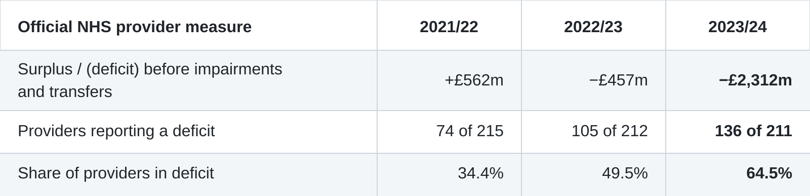
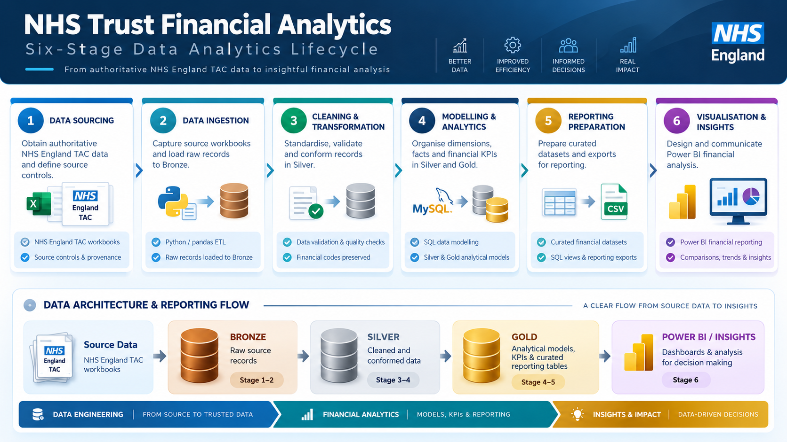
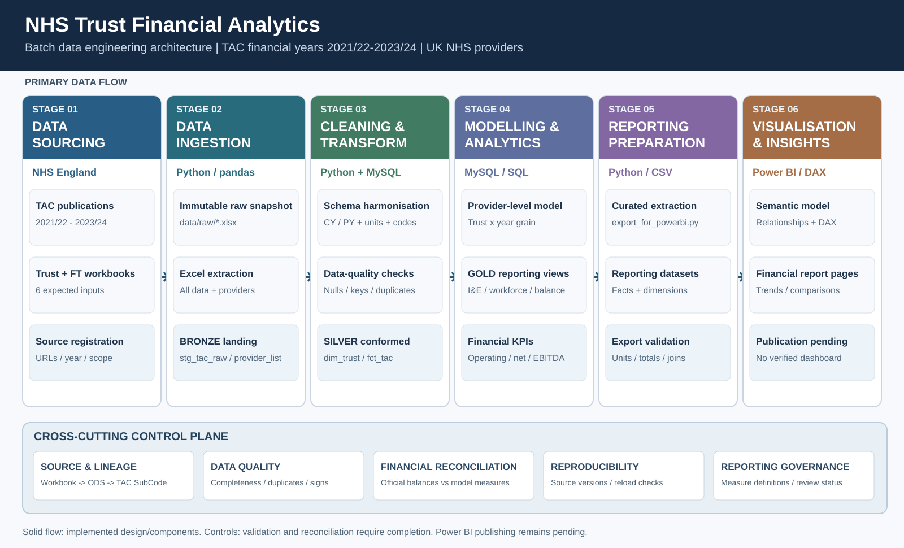

# NHS Trust Financial Analytics

This project was motivated by a need to understand the growing financial pressures facing NHS Trusts in England and identify what the published accounts reveal about their sustainability. I used NHS England's Trust Accounts Consolidation data, alongside Python, MySQL and financial analytics techniques, to investigate how financial performance changed across three reporting years.

## The research question

> **How is the financial health of NHS Trusts in England changing over time, and which parts of the health system are under the most pressure?**

**What the published accounts show:** NHS England reported a £562 million surplus in 2021/22, a £457 million deficit in 2022/23 and a £2.312 billion deficit in 2023/24, measured before impairments and transfers. The proportion of providers reporting a deficit increased from about 34% to 64%. These figures show a worsening financial position but do not, on their own, identify the cause.

**How I investigated it:** I used NHS England's published Trust Accounts Consolidation data for three financial years, processed and standardised the source records with Python, and developed MySQL analytical views and financial measures for cross-year and trust-level comparison. The project also includes a Power BI reporting model; the dashboard itself is pending publication.

[Explore the full project methodology and documentation](PROJECT_DOCUMENTATION.md).

## Key findings

View the findings as a text table

<table width="100%">
  <thead><tr><th align="left" width="49%">Official NHS provider measure</th><th align="right" width="17%">2021/22</th><th align="right" width="17%">2022/23</th><th align="right" width="17%">2023/24</th></tr></thead>
  <tbody>
    <tr><td>Surplus / (deficit) before impairments and transfers</td><td align="right">+£562m</td><td align="right">−£457m</td><td align="right"><strong>−£2,312m</strong></td></tr>
    <tr><td>Providers reporting a deficit</td><td align="right">74 of 215</td><td align="right">105 of 212</td><td align="right"><strong>136 of 211</strong></td></tr>
    <tr><td>Share of providers in deficit</td><td align="right">34.4%</td><td align="right">49.5%</td><td align="right"><strong>64.5%</strong></td></tr>
  </tbody>
</table>

**Why it matters:** The figures reveal a widening financial sustainability challenge and make it important to investigate which providers and spending categories face the greatest pressure. They do not, by themselves, establish a single cause of the deterioration.

**Basis and limitations:** The figures above come from NHS England's official consolidated provider accounts, not a fresh execution of this project's SQL. The project's existing TAC-derived operating measure (subcode `SCI0140A`) is different and still needs reconciliation against source data before being reported as validated. The supporting project documentation and financial review have not yet been reconciled.

The 2023/24 deficit includes a £1.094 billion impact from changes in the accounting treatment of PFI liabilities under IFRS 16, affecting comparability.

**Official accounts:** [2021/22](https://www.gov.uk/government/publications/consolidated-nhs-provider-accounts-2021-to-2022) | [2022/23](https://www.gov.uk/government/publications/consolidated-nhs-provider-accounts-2022-to-2023) | [2023/24](https://www.gov.uk/government/publications/consolidated-nhs-provider-accounts-2023-to-2024).

See [Project Documentation](PROJECT_DOCUMENTATION.md) and the [2023/24 Financial Review](reports/nhs_sector_financial_review_2324.md) for the existing project calculations, which require review.

[Financial reconciliation workpaper](reports/nhs_financial_reconciliation.md) documents the official accounting bridge, differences in existing SQL metrics and outstanding validation steps.

## Power BI dashboard

**Dashboard publication pending.** The repository includes the Power BI model reference, report page specifications and DAX measure definitions, but no published report or report-page screenshot is available to link here yet.

The report design covers an executive summary, income and expenditure, cost pressures, trust benchmarking and workforce analysis. A genuine dashboard screenshot and verified report link will be added after publication.

[Power BI setup guide](power_bi/setup_guide.md) | [DAX measures](power_bi/dax_measures.md)

## Data architecture

### Six-stage data analytics lifecycle

The diagram connects the six methodological stages to NHS England TAC source data, Bronze raw records, Silver conformed financial records, Gold analytical models and the Power BI reporting layer. The dashboard is not yet published.

The six stages are Data Sourcing, Data Ingestion, Data Cleaning & Transformation, Data Modelling & Analytics, Data Preparation for Reporting, and Data Visualisation & Insights. The implementation uses MySQL Bronze, Silver and Gold layers. The Power BI dashboard remains pending publication. The detailed schema, data checks, source mapping and implementation choices are explained in [Project Documentation](PROJECT_DOCUMENTATION.md).

## Documentation and reproducibility

| Resource | Contents |
| --- | --- |
| [Project Documentation](PROJECT_DOCUMENTATION.md) | Business case, source data, methodology, architecture and implementation |
| [2023/24 Financial Review](reports/nhs_sector_financial_review_2324.md) | Detailed findings and financial interpretation |
| [Power BI Setup Guide](power_bi/setup_guide.md) | Relationships and proposed report pages |
| [DAX Measures](power_bi/dax_measures.md) | Financial reporting calculations |
| [NHS KPI Definitions](agent_docs/kpi_definitions.md) | Definitions and reporting conventions |
| [Development Notes](notebook/) | Stage-by-stage implementation history |

**Source:** [NHS England Trust Accounts Consolidation publications](https://www.england.nhs.uk/financial-accounting-reporting-systems/nhs-england-finance-returns-publications-guidance/trust-accounts-consolidation-tac/).

To reproduce the pipeline, obtain the corresponding annual TAC workbooks, configure Python 3.11+ and MySQL 8+, and follow the documented ingestion, validation and export steps in [Project Documentation](PROJECT_DOCUMENTATION.md). The underlying source workbooks and generated exports are not committed to this repository.

## Author

**Teslim Adeyanju** | [Portfolio](https://adeyanjuteslim.co.uk) | [LinkedIn](https://www.linkedin.com/in/adeyanjuteslimuthman)

[Previous README (full archive)](docs/readme-history.md)
