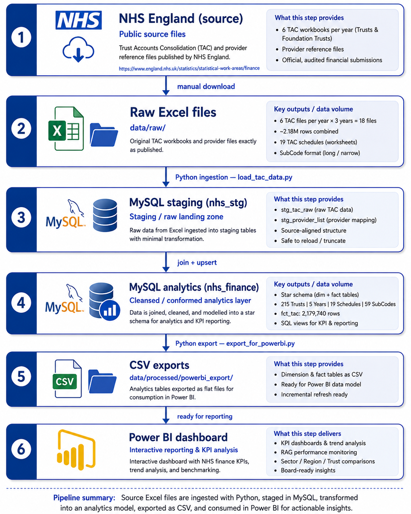

# NHS Trust Financial Analytics

This project was motivated by a need to understand the growing financial pressures facing NHS Trusts in England and identify what the published accounts reveal about their sustainability. I used NHS England's Trust Accounts Consolidation data, alongside Python, MySQL and financial analytics techniques, to investigate how financial performance changed across three reporting years.

## The research question

> **How is the financial health of NHS Trusts in England changing over time, and which parts of the health system are under the most pressure?**

**What the analysis found:** Between 2021/22 and 2023/24, the sector's reported operating position deteriorated from a £1.6bn surplus to a £1.6bn deficit. Provider expenditure rose faster than income, while the number of trusts reporting deficits increased from 37 of 211 to 124 of 206. These findings point to growing financial pressure across NHS providers, although the headline figures alone do not establish which individual trusts or cost categories experienced the greatest pressure.

**How I investigated it:** I used NHS England's published Trust Accounts Consolidation data for three financial years, processed and standardised the source records with Python, and developed MySQL analytical views and financial measures for cross-year and trust-level comparison. The project also includes a Power BI reporting model; the dashboard itself is pending publication.

[Explore the full project methodology and documentation](PROJECT_DOCUMENTATION.md).

## Key findings

<table width="100%">
  <thead>
    <tr>
      <th align="left" width="49%">Indicator</th>
      <th align="right" width="17%">2021/22</th>
      <th align="right" width="17%">2022/23</th>
      <th align="right" width="17%">2023/24</th>
    </tr>
  </thead>
  <tbody>
    <tr><td>Total provider income</td><td align="right">£110.3bn</td><td align="right">£118.4bn</td><td align="right">£129.2bn</td></tr>
    <tr><td>Total provider expenditure</td><td align="right">£108.7bn</td><td align="right">£118.2bn</td><td align="right">£130.8bn</td></tr>
    <tr><td>Reported operating surplus / (deficit)</td><td align="right">+£1.6bn</td><td align="right">+£148m</td><td align="right"><strong>−£1.6bn</strong></td></tr>
    <tr><td>Trusts reporting a deficit</td><td align="right">37 of 211</td><td align="right">85 of 207</td><td align="right"><strong>124 of 206</strong></td></tr>
  </tbody>
</table>

**Why it matters:** The figures reveal a widening financial sustainability challenge and make it important to investigate which providers and spending categories face the greatest pressure. They do not, by themselves, establish a single cause of the deterioration.

Figures are taken from the project's existing analysis, not newly audited in this README revision. For calculations, assumptions, financial conventions and interpretation, read the [2023/24 Financial Review](reports/nhs_sector_financial_review_2324.md).

## Power BI dashboard

**Dashboard publication pending.** The repository includes the Power BI model reference, report page specifications and DAX measure definitions, but no published report or report-page screenshot is available to link here yet.

The report design covers an executive summary, income and expenditure, cost pressures, trust benchmarking and workforce analysis. A genuine dashboard screenshot and verified report link will be added after publication.

[Power BI setup guide](power_bi/setup_guide.md) | [DAX measures](power_bi/dax_measures.md)

## Data architecture

The workflow takes published NHS England accounts workbooks through Python ingestion and MySQL staging, prepares analytical views and exports data for Power BI. The detailed schema, data checks, source mapping and implementation choices are explained in [Project Documentation](PROJECT_DOCUMENTATION.md).

## Documentation and reproducibility

| Resource | Contents |
| --- | --- |
| [Project Documentation](PROJECT_DOCUMENTATION.md) | Business case, source data, methodology, architecture and implementation |
| [2023/24 Financial Review](reports/nhs_sector_financial_review_2324.md) | Detailed findings and financial interpretation |
| [Power BI Setup Guide](power_bi/setup_guide.md) | Relationships and proposed report pages |
| [DAX Measures](power_bi/dax_measures.md) | Financial reporting calculations |
| [NHS KPI Definitions](agent_docs/kpi_definitions.md) | Definitions and reporting conventions |
| [Development Notes](notebook/) | Stage-by-stage implementation history |

**Source:** [NHS England Trust Accounts Consolidation publications](https://www.england.nhs.uk/financial-accounting-reporting-systems/nhs-england-finance-returns-publications-guidance/trust-accounts-consolidation-tac/).

To reproduce the pipeline, obtain the corresponding annual TAC workbooks, configure Python 3.11+ and MySQL 8+, and follow the documented ingestion, validation and export steps in [Project Documentation](PROJECT_DOCUMENTATION.md). The underlying source workbooks and generated exports are not committed to this repository.

## Author

**Teslim Adeyanju** | [Portfolio](https://adeyanjuteslim.co.uk) | [LinkedIn](https://www.linkedin.com/in/adeyanjuteslimuthman)

[Previous README (full archive)](docs/readme-history.md)
