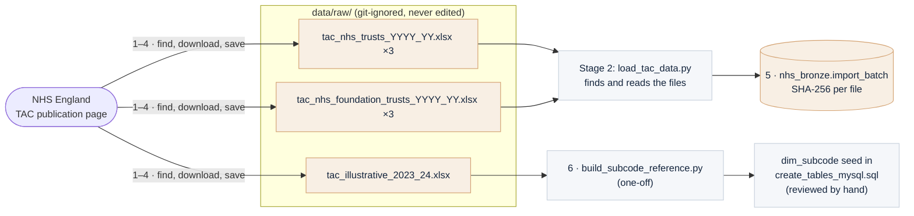

# Stage 1: Data Sourcing

**Implementation:** NHS England TAC publications and source provenance.

> This stage gives every later stage a named starting point: the exact publication the project is built
> on, how it gets into `data/raw/`, and why it can't be queried directly.

---

## How the Data Reaches the Project

- **NHS England publishes it.** The Trust Accounts Consolidation (TAC) workbooks are open data on the
  [NHS England TAC page](https://www.england.nhs.uk/financial-accounting-reporting-systems/nhs-england-finance-returns-publications-guidance/trust-accounts-consolidation-tac/).
- **There is no API.** Each workbook is downloaded by hand after accepting NHS England's terms of use.
- **The files land in `data/raw/`**, named so the loader can read the year and trust type from the name.
  The folder is git-ignored, and the files are never edited.
- **No pipeline code runs here.** The pipeline starts in [stage ②](../02_data_ingestion/README.md), from
  files already on disk. One one-off helper reads the illustrative workbook (step 6).

### The sourcing steps

These steps are manual, except step 6. The **Source** column shows where each one is defined or recorded.

**A. Find the publication**

| # | Action | Source | What it does |
|---|--------|--------|--------------|
| 1 | Open the TAC publication page | [NHS England TAC page](https://www.england.nhs.uk/financial-accounting-reporting-systems/nhs-england-finance-returns-publications-guidance/trust-accounts-consolidation-tac/) | One page per financial year's publication |
| 2 | Pick the workbooks | [NHS England TAC page](https://www.england.nhs.uk/financial-accounting-reporting-systems/nhs-england-finance-returns-publications-guidance/trust-accounts-consolidation-tac/) | Two per year (NHS Trusts, Foundation Trusts), plus the illustrative workbook |

**B. Download and save**

| # | Action | Source | What it does |
|---|--------|--------|--------------|
| 3 | Accept the terms and download | [NHS England TAC page](https://www.england.nhs.uk/financial-accounting-reporting-systems/nhs-england-finance-returns-publications-guidance/trust-accounts-consolidation-tac/) | One `.xlsx` workbook per year per trust population |
| 4 | Save into `data/raw/` as `tac_nhs_trusts_YYYY_YY.xlsx` / `tac_nhs_foundation_trusts_YYYY_YY.xlsx` | [`load_tac_data.py`](../../python/ingestion/load_tac_data.py) → `find_tac_files()` | The names the loader looks for ([stage ②](../02_data_ingestion/README.md), step 0) |

**C. Record and reuse**

| # | Action | Source | What it does |
|---|--------|--------|--------------|
| 5 | Fingerprint each file (automatic, on load) | [`load_tac_data.py`](../../python/ingestion/load_tac_data.py) → `sha256_file()`, `record_import_batch()` | Records the file's SHA-256 in `nhs_bronze.import_batch` |
| 6 | Generate SubCode labels (one-off) | [`build_subcode_reference.py`](../../python/ingestion/build_subcode_reference.py) | Reads the illustrative workbook and writes a `dim_subcode` seed for review |

---

## How It Works

### Steps 1–3 — what TAC is, and where it comes from

**Trust Accounts Consolidation (TAC)** is NHS England's annual process of collecting the audited
statutory accounts of every NHS Trust and NHS Foundation Trust, in a standardised Excel template, and
publishing the consolidated result as open data.

- **Source:** [NHS England — Trust Accounts Consolidation (TAC)](https://www.england.nhs.uk/financial-accounting-reporting-systems/nhs-england-finance-returns-publications-guidance/trust-accounts-consolidation-tac/)
- **Cadence:** annual, published after year-end audit sign-off — this is why the dataset has no monthly
  grain anywhere downstream. TAC is a year-end return, not an in-year management report.
- **Format:** one workbook per year per trust population (NHS Trusts / Foundation Trusts are published
  separately, so a given financial year is two files, not one)

### Step 4 — the files in `data/raw/` are a copy, not the source

Every other stage in this pipeline is something *I* built. This one isn't — it's the fixed, external
authority everything else is validated against. Keeping it as its own stage (rather than folding it into
"raw files") makes an important distinction explicit: `data/raw/*.xlsx` is a **copy**, not the source. If a
number ever looks wrong, the question "is this what NHS England actually published, or did my pipeline
introduce the error?" always has an answer, because the original publication is a fixed, external
reference point independent of anything in this repository.

### Step 5 — the fingerprint

**The fingerprint.** The loader stores the SHA-256 of each source workbook, alongside its file size,
financial year, trust type, row counts, integrity results and final load status, in
`nhs_bronze.import_batch` ([stage ③](../03_data_cleaning_and_transformation/README.md), steps 3–4). The
workbooks are git-ignored, so after a re-download, compare the new file's SHA-256 with that audit rather than
relying on the file name alone. A different fingerprint means NHS England changed the file.

### Conventions set here, used in every stage

Two conventions established at the source apply to every table, column, and file downstream:

- **Financial year:** 1 April – 31 March, labelled `YYYY/YY` (e.g. `2023/24`). Every filter in every SQL
  view, every Python script, and every DAX measure in this project uses `financial_year` — never a
  calendar-year or calendar-month column, because none exists.
- **Currency:** every monetary figure NHS England publishes is in **£ thousands (£000s)**. This project
  keeps that unit all the way through SQL and CSV, and converts to £m only at the very last step — inside
  DAX measures on import into Power BI (see [stage ⑥](../06_data_visualisation_and_insights/README.md)).
  There is one deliberate exception: `sector_benchmarks.csv` is pre-aggregated in £m (see
  [stage ⑤](../05_data_preparation_for_reporting/README.md)). £000 does not imply whole numbers: the
  source files contain values to five decimal places.

### Step 6 — the one script that reads a source file directly

No pipeline code runs in this stage: it is the boundary between "data NHS England is responsible for" and
"code I'm responsible for", which is why [stage ②](../02_data_ingestion/README.md) treats the downloaded
files as fixed input to audit against, not something to clean in place.

The one exception is a one-off helper. [`build_subcode_reference.py`](../../python/ingestion/build_subcode_reference.py) reads the illustrative workbook and generates labels for
every SubCode the project doesn't label by hand, completing the roughly 1,000-row `dim_subcode` reference. It writes
`data/processed/subcode_reference_seed.sql` and `subcode_reference.md` for review; the reviewed rows were
merged by hand into the `dim_subcode` seed in
[`create_tables_mysql.sql`](../../sql/schema/create_tables_mysql.sql) ([SQL Guide, step 3e](../sql_database_guide/README.md#silver-the-star-schema)).
Rerun it only if NHS England revises the illustrative workbook.

---

## Relevant Files

| File | What to Read |
|------|-------------|
| [project_documentation.md](../../project_documentation.md), stage ① | The narrative version of this stage, plus the business case for the whole project |
| [project_documentation.md](../../project_documentation.md), Sections 1–3 | NHS background, the financial crisis in numbers, project objectives |
| [python/ingestion/build_subcode_reference.py](../../python/ingestion/build_subcode_reference.py) | Step 6: the one-off SubCode label generator |

---

*Next: [Stage ② — Data Ingestion](../02_data_ingestion/README.md)*
