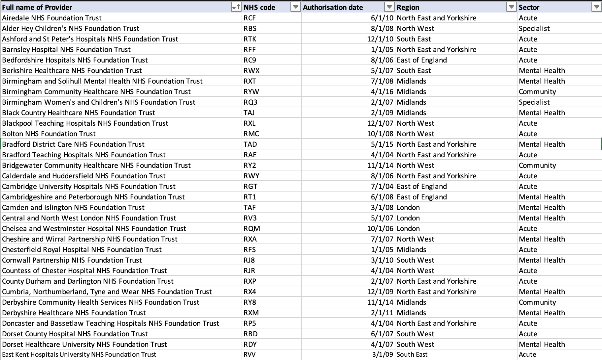

---
markmap:
  initialExpandLevel: 2
  colorFreezeLevel: 2
---

# Stage 2: Data Ingestion

**Implementation:** Original Excel workbooks downloaded manually to `data/raw/`; Python reads them and lands them in Bronze staging.

> This stage is about understanding the exact shape of the data before any code runs. The Python
> pipeline receives these files and has to deal with exactly what NHS England published — no cleaning,
> no reformatting, nothing assumed.

---

## 2.1 The 6 Files

```text
data/raw/
  tac_nhs_trusts_2021_22.xlsx             16MB  —  70 provider-list rows
  tac_nhs_foundation_trusts_2021_22.xlsx  33MB  — 145 provider-list rows
  tac_nhs_trusts_2022_23.xlsx             20MB  —  69 provider-list rows
  tac_nhs_foundation_trusts_2022_23.xlsx  36MB  — 144 provider-list rows
  tac_nhs_trusts_2023_24.xlsx             18MB  —  68 provider-list rows
  tac_nhs_foundation_trusts_2023_24.xlsx  38MB  — 143 provider-list rows
```

**Why 2 files per year?** NHS Trusts and Foundation Trusts are published separately. Same column
structure, different populations. The pipeline treats them identically — the filename tells the code
which type it is.

**Why are they large?** Long/narrow format — roughly 7,000 rows per listed provider, covering both the
current year and the prior-year comparison. The 2023/24 NHS Trusts file alone has 481,140 rows for 68
listed providers.

**The illustrative file** (`tac_illustrative_2023_24.xlsx`) is a reference schema file showing every
SubCode and its description, not real trust data. The pipeline explicitly skips it:

```python
# python/ingestion/load_tac_data.py
def find_tac_files(raw_dir: Path) -> list[Path]:
    return sorted(
        (
            p for p in raw_dir.glob("*.xlsx")
            if p.name.lower().startswith("tac_nhs_")
            and "illustrative" not in p.name.lower()
        ),
        key=lambda p: p.name.lower(),
    )
```

---

## 2.2 Inside Each File: Two Sheets That Matter

### 2.2.1 Sheet 1 — "List of Providers"

Small annual lookup table, one row per listed provider (68–70 NHS Trust rows or 143–145 Foundation Trust
rows in the verified files). Not every listed provider necessarily has populated CY fact rows.

| Column | Example |
| ------ | ------- |
| Full name of Provider | `Airedale NHS Foundation Trust` |
| NHS code | `RCF` |
| Authorisation date | `6/1/10` |
| Region | `North East and Yorkshire` |
| Sector | `Acute` |



**Purpose:** provides the ODS code for each trust by name. The "All data" sheet has names, not codes —
this sheet resolves that gap. The source also includes authorisation dates, but the current pipeline does
not load that field; it carries the provider name, ODS code, region, and sector into staging.

The pipeline keeps only rows with a name and an `org_code` of exactly 3 letters or digits:

```python
df = df[
    df["org_code"].str.fullmatch(r"[A-Za-z0-9]{3}", na=False)   # drops blank rows, header artefacts
    & df["organisation_name"].ne("")
]
```

### 2.2.2 Sheet 2 — "All data"

The main data sheet: about 433,000–481,000 rows per NHS Trusts file and 884,000–1,006,000 per Foundation
Trusts file (the rows preserved in Bronze in the verified run), long/narrow, exactly 7 columns. Each row is one reported amount: the trust and TAC schedule identify the context,
`TableID` and `MainCode` locate the source table and column, and `RowNumber` and `SubCode` identify the
line item.

| Source column | What it identifies | Example from the screenshot |
| ------------- | ------------------ | --------------------------- |
| `Organisation Name` | Trust reporting the figure | `Airedale NHS Foundation Trust` |
| `WorkSheetName` | TAC schedule | `TAC02 SoCI` |
| `TableID` | Table within that schedule | `1` |
| `MainCode` | Source column, including year type | `A02CY01` |
| `RowNumber` | Line position on the original form | `12` |
| `SubCode` | Financial line item | `SCI0100A` |
| `Value number` | Amount, in £000s | `218,758.00` |

Each row is one reported amount. The schedule and table show where it came from; `MainCode` identifies its
column; `RowNumber` and `SubCode` identify the line item. The value is in £000s.


In the first row, `Airedale NHS Foundation Trust` is the organisation, `TAC02 SoCI` is the schedule,
`TableID` is 1, and `A02CY01` identifies the current-year column. `RowNumber` 12 and `SubCode` `SCI0100A`
locate the patient-care-income line; `218,758.00` is its amount in £000s. The repeated `A02CY01` values
show that these rows belong to the same column, while their row numbers and SubCodes identify different
lines.

`MainCode` follows the pattern `A{schedule_number}{CY|PY}{column_number}[optional suffix]`. In
`A02CY01`, `A02` means schedule TAC02, `CY` means Current Year, and `01` means column 1. The trailing
number is a **column number**, not a table number; `TableID` stores the table separately. Some schedules
add a category suffix, such as `P` for permanent staff in `A09CY01P`.

In the original TAC table, `SubCode` labels the line and `MainCode` labels the value column; "All data"
flattens their intersection into one record. In the screenshot, `A02PY01` marks the prior-year comparison
column alongside `A02CY01`. Because this is the 2021/22 workbook, its PY values are for 2020/21. Both
CY and PY rows are kept in Bronze as source evidence ([stage ③](../03_data_cleaning_and_transformation/README.md));
only populated CY rows are promoted to the Silver fact table
([stage ④](../04_data_modelling_and_analytics/README.md)), so comparison years are never counted twice
when workbooks are combined.

---

## 2.3 A Key Inconsistency Across File Versions

NHS England changed column names between 2021/22 and later files:

| 2021/22 column name | 2022/23+ column name | What it is      |
|-----------------------|-----------------------|-------------------|
| `Organisation Name`   | `OrganisationName`   | Trust name        |
| `Value number`        | `Total`               | The £000s value   |

The pipeline handles this silently:

```python
col_map = {
    "Organisation Name": "OrganisationName",
    "Value number":      "Total",
    "Value Number":      "Total",
}
df = df.rename(columns=col_map)
```

Without this, pandas would produce a DataFrame with an unexpected column name and the pipeline would fail
with a missing-column error on the 2021/22 files specifically. This is a real-world data-engineering
problem: an external source changed format mid-series, and the pipeline has to absorb that transparently
rather than special-casing "the old files" by hand.

---

## 2.4 What the Pipeline Reads from the Filename — Before Opening the File

Two critical facts live only in the filename, not inside the workbook:

```python
YEAR_RE = re.compile(r"(\d{4})[-_](\d{2})")   # 2023-24 or 2023_24

def filename_to_financial_year(filename: str) -> str:
    match = YEAR_RE.search(filename)
    return f"{match.group(1)}/{match.group(2)}"   # "2023_24" → "2023/24"

def filename_to_trust_type(filename: str) -> str:
    return "FOUNDATION_TRUST" if "foundation" in filename.lower() else "NHS_TRUST"
```

Both `financial_year` and `trust_type` are attached to every row of data as extra columns before anything
else happens. Rename a file and the pipeline mis-tags every row inside it — the exact filenames matter.

---

## 2.5 Raw Data Quality Issues and How They're Handled

| Issue | How handled |
|-------|-------------|
| `Total` column arrives as float (Excel `NaN` for blanks) | Preserve blanks as `NULL` in Bronze; numeric zero remains a genuine zero |
| Organisation names have trailing spaces | `.str.strip()` on every string column |
| Negative values in expenditure | Valid — stored as-is; sign convention follows TAC, not remapped |
| PY rows mixed with CY rows | Preserve both in Bronze; filter to CY only during Silver promotion |
| Genuine fractional £000 amounts | Round only to the source's five-decimal precision and store as `DECIMAL(18,5)`; never coerce to whole thousands |

---

## 2.6 Stage ② Summary

| What you see in the raw file              | What it means                                         |
|---------------------------------------------|----------------------------------------------------------|
| 2 sheets per file                           | "List of Providers" = lookup; "All data" = facts        |
| 7 columns in "All data"                     | Minimal structure to identify any line for any trust     |
| CY and PY rows mixed                        | Preserve both in Bronze; promote CY to Silver            |
| Name in "All data", code in provider list   | Use deterministic normalisation and reviewed aliases to resolve ODS codes |
| Column names differ in 2021/22              | Pipeline handles format changes silently                 |
| Total in £000s                              | Never divide or multiply here — store as-is              |

---

## 2.7 Relevant Files

| File | What to Read |
|------|-------------|
| `data/raw/` (git-ignored, local only) | Open any TAC `.xlsx` in Excel — examine both sheets directly |
| [agent_docs/data_dictionary.md](../../agent_docs/data_dictionary.md) | Full SubCode reference, MainCode format, data-quality notes |
| [project_documentation.md](../../project_documentation.md), stage ② | The narrative version, plus the "how I sourced the data" story |
| [python/ingestion/load_tac_data.py](../../python/ingestion/load_tac_data.py) | `filename_to_financial_year()`, `filename_to_trust_type()`, `read_provider_list()`, `read_all_data()` |

---

*Previous: [Stage ① — Data Sourcing](../01_data_sourcing/README.md)*
*Next: [Stage ③ — Data Cleaning & Transformation](../03_data_cleaning_and_transformation/README.md)*
