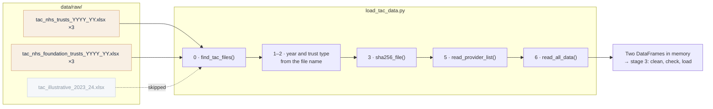
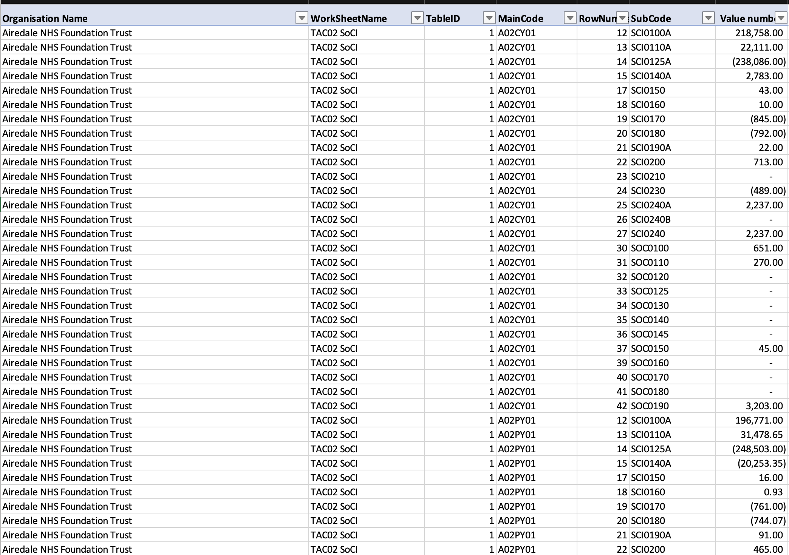

# Stage 2: Data Ingestion

**Implementation:** Original Excel workbooks downloaded manually to `data/raw/`; Python finds them and reads
their two sheets.

> This stage is about the exact shape of the data before any cleaning: which files there are, what is
> inside them, and how the loader finds and opens them. The pipeline has to deal with exactly what NHS
> England published, with nothing assumed.

---

## How the Files Reach Python

- **The files are downloaded by hand** into `data/raw/` ([stage ①](../01_data_sourcing/README.md)). The
  folder is git-ignored, and the files are never edited.
- **Python finds them by name.** [`load_tac_data.py`](../../python/ingestion/load_tac_data.py) picks up every `tac_nhs_*.xlsx` file in `data/raw/`, whatever the
  capitalisation, and skips the illustrative workbook.
- **The file name carries two facts** the workbook doesn't: the financial year and the trust type.
- **Python reads two sheets** from each file into memory. Nothing is written to the database in this
  stage; cleaning, checking and loading are [stage ③](../03_data_cleaning_and_transformation/README.md).

### The reading steps, one file at a time

These are the steps of the [stage ③ flow](../03_data_cleaning_and_transformation/README.md#the-full-flow-for-one-workbook)
that touch the raw file, with the same numbers. Step 0 runs once for the whole folder.

**A. Find the files** (once per run)

| # | Function | Source | What it reads | Result |
|---|----------|--------|---------------|--------|
| 0 | `find_tac_files()` | [`load_tac_data.py`](../../python/ingestion/load_tac_data.py) | The file names in `data/raw/` | The six data workbooks, sorted by name |

**B. Read the file name** (per file)

| # | Function | Source | What it reads | Result |
|---|----------|--------|---------------|--------|
| 1 | `filename_to_financial_year()` | [`load_tac_data.py`](../../python/ingestion/load_tac_data.py) | The year in the name | `…_2021_22.xlsx` → `2021/22` |
| 2 | `filename_to_trust_type()` | [`load_tac_data.py`](../../python/ingestion/load_tac_data.py) | Whether the name contains `foundation` | `FOUNDATION_TRUST` or `NHS_TRUST` |
| 3 | `sha256_file()` | [`source_integrity.py`](../../python/ingestion/source_integrity.py) | The file's bytes | A fingerprint of this exact version of the file |

**C. Open the two sheets** (per file)

| # | Function | Source | What it reads | Result |
|---|----------|--------|---------------|--------|
| 5 | `read_provider_list()` | [`load_tac_data.py`](../../python/ingestion/load_tac_data.py) | The "List of Providers" sheet | A DataFrame of trust names and ODS codes |
| 6 | `read_all_data()` | [`load_tac_data.py`](../../python/ingestion/load_tac_data.py) | The "All data" sheet, found by `find_sheet_name()` | A DataFrame of every reported amount, with standard column names |

Step 4 (logging the file in `import_batch`) is the one step in that range that writes to the database, so
it belongs to stage ③.



---

## How It Works in the Code

### Step 0 — the six files

```text
data/raw/
  tac_nhs_trusts_2021_22.xlsx
  tac_nhs_foundation_trusts_2021_22.xlsx
  tac_nhs_trusts_2022_23.xlsx
  tac_nhs_foundation_trusts_2022_23.xlsx
  tac_nhs_trusts_2023_24.xlsx
  tac_nhs_foundation_trusts_2023_24.xlsx
  tac_illustrative_2023_24.xlsx            ← reference only, skipped
```

**Why 2 files per year?** NHS Trusts and Foundation Trusts are published separately. Same column
structure, different populations. The pipeline treats them identically; the file name tells the code which
type it is.

**Why are they large?** They're in long/narrow format: roughly 7,000 rows per listed provider, covering both
the current year and the prior-year comparison.

**The illustrative file** (`tac_illustrative_2023_24.xlsx`) is a reference file showing every SubCode and
its description, not real trust data. `find_tac_files()` skips it, and matches the data files whatever
their capitalisation, so both `tac_nhs_trusts_2021_22.xlsx` and NHS England's original
`TAC_NHS_trusts_2021-22.xlsx` style work:

```python
def find_tac_files(raw_dir: Path) -> list[Path]:
    return sorted(
        (
            p for p in raw_dir.glob("*.xlsx")
            if p.name.lower().startswith("tac_nhs_")
            and "illustrative" not in p.name.lower()
        ),
        key=lambda p: p.name.lower(),
    )
```

Sorting by name means all Foundation Trust years load before all NHS Trust years, not in date order.
Stage ④'s `dim_trust` load is written so that order doesn't matter.

### Steps 1–2 — what the pipeline reads from the file name

Two facts live only in the file name, not inside the workbook:

```python
YEAR_RE = re.compile(r"(\d{4})[-_](\d{2})")   # 2023-24 or 2023_24

def filename_to_financial_year(filename: str) -> str:
    match = YEAR_RE.search(filename)
    return f"{match.group(1)}/{match.group(2)}"   # "2023_24" → "2023/24"

def filename_to_trust_type(filename: str) -> str:
    return "FOUNDATION_TRUST" if "foundation" in filename.lower() else "NHS_TRUST"
```

Both `financial_year` and `trust_type` are attached to every row of the file as extra columns. Rename a
file wrongly and the pipeline mis-tags every row inside it, so the exact file names matter.

### Step 5 — Sheet 1, "List of Providers"

A small lookup table, one row per listed provider, read by `read_provider_list()`. Not every listed
provider necessarily has populated current-year figures.

| Column | Example |
| ------ | ------- |
| Full name of Provider | `Airedale NHS Foundation Trust` |
| NHS code | `RCF` |
| Authorisation date | `6/1/10` |
| Region | `North East and Yorkshire` |
| Sector | `Acute` |


**Purpose:** provides the ODS code for each trust by name. The "All data" sheet has names, not codes —
this sheet resolves that gap. The source also includes authorisation dates, but the current pipeline does
not load that field; it carries the provider name, ODS code, region, and sector into staging.

The pipeline keeps only rows with a name and an `org_code` of exactly 3 letters or digits:

```python
df = df[
    df["org_code"].str.fullmatch(r"[A-Za-z0-9]{3}", na=False)   # drops blank rows, header artefacts
    & df["organisation_name"].ne("")
]
```

### Step 6 — Sheet 2, "All data"

The main data sheet, read by `read_all_data()` after `find_sheet_name()` has found it as "All data" or "All
Data". It is long and narrow: hundreds of thousands of rows per file, but exactly 7 columns.

| Source column | What it identifies | Example from the screenshot |
| ------------- | ------------------ | --------------------------- |
| `Organisation Name` | Trust reporting the figure | `Airedale NHS Foundation Trust` |
| `WorkSheetName` | TAC schedule | `TAC02 SoCI` |
| `TableID` | Table within that schedule | `1` |
| `MainCode` | Source column, including year type | `A02CY01` |
| `RowNumber` | Line position on the original form | `12` |
| `SubCode` | Financial line item | `SCI0100A` |
| `Value number` | Amount, in £000s | `218,758.00` |

Each row is one reported amount: the trust and TAC schedule give the context, `TableID` and `MainCode`
locate the source table and column, `RowNumber` and `SubCode` identify the line item, and the value is in
£000s.



In the first row, `Airedale NHS Foundation Trust` is the organisation, `TAC02 SoCI` is the schedule,
`TableID` is 1, and `A02CY01` identifies the current-year column. `RowNumber` 12 and `SubCode` `SCI0100A`
locate the patient-care-income line; `218,758.00` is its amount in £000s. The repeated `A02CY01` values
show that these rows belong to the same column, while their row numbers and SubCodes identify different
lines.

`MainCode` follows the pattern `A{schedule_number}{CY|PY}{column_number}[optional suffix]`. In
`A02CY01`, `A02` means schedule TAC02, `CY` means Current Year, and `01` means column 1. The trailing
number is a **column number**, not a table number; `TableID` stores the table separately. Some schedules
add a category suffix, such as `P` for permanent staff in `A09CY01P`.

In the original TAC table, `SubCode` labels the line and `MainCode` labels the value column; "All data"
flattens their intersection into one record. In the screenshot, `A02PY01` marks the prior-year comparison
column alongside `A02CY01`. Because this is the 2021/22 workbook, its PY values are for 2020/21. Both
CY and PY rows are kept in Bronze as source evidence ([stage ③](../03_data_cleaning_and_transformation/README.md));
only populated CY rows are promoted to the Silver fact table
([stage ④](../04_data_modelling_and_analytics/README.md)), so comparison years are never counted twice
when workbooks are combined.

### Step 6 — a key inconsistency across file versions

NHS England changed column names between 2021/22 and later files:

| 2021/22 column name | 2022/23+ column name | What it is      |
|-----------------------|-----------------------|-------------------|
| `Organisation Name`   | `OrganisationName`   | Trust name        |
| `Value number`        | `Total`               | The £000s value   |

`read_all_data()` handles this with a rename map:

```python
col_map = {
    "Organisation Name": "OrganisationName",
    "Value number":      "Total",
    "Value Number":      "Total",
}
df = df.rename(columns=col_map)
```

Without this, pandas would produce a DataFrame with an unexpected column name and the pipeline would fail
with a missing-column error on the 2021/22 files specifically. This is a real-world data-engineering
problem: an external source changed format mid-series, and the pipeline has to absorb that transparently
rather than special-casing "the old files" by hand.

---

## Raw Data Quality Issues and How They're Handled

| Issue | How handled |
|-------|-------------|
| `Total` column arrives as float (Excel `NaN` for blanks) | Preserve blanks as `NULL` in Bronze; numeric zero remains a genuine zero |
| Organisation names have trailing spaces | `.str.strip()` on every string column |
| Negative values in expenditure | Valid — stored as-is; sign convention follows TAC, not remapped |
| PY rows mixed with CY rows | Preserve both in Bronze; filter to CY only during Silver promotion |
| Genuine fractional £000 amounts | Round only to the source's five-decimal precision and store as `DECIMAL(18,5)`; never coerce to whole thousands |

---

## Stage ② Summary

| What you see in the raw file              | What it means                                         |
|---------------------------------------------|----------------------------------------------------------|
| Year and trust type only in the file name   | `find_tac_files()` accepts `tac_nhs_…_2021_22` or `TAC_NHS_…_2021-22`; the name is parsed for both |
| 2 sheets per file                           | "List of Providers" = lookup; "All data" = facts        |
| 7 columns in "All data"                     | Minimal structure to identify any line for any trust     |
| CY and PY rows mixed                        | Preserve both in Bronze; promote CY to Silver            |
| Name in "All data", code in provider list   | Use deterministic normalisation and reviewed aliases to resolve ODS codes |
| Column names differ in 2021/22              | Pipeline handles format changes silently                 |
| Total in £000s                              | Never divide or multiply here — store as-is              |

---

## Relevant Files

| File | What to Read |
|------|-------------|
| `data/raw/` (git-ignored, local only) | Open any TAC `.xlsx` in Excel — examine both sheets directly |
| [agent_docs/data_dictionary.md](../../agent_docs/data_dictionary.md) | Full SubCode reference, MainCode format, data-quality notes |
| [project_documentation.md](../../project_documentation.md), stage ② | The narrative version, plus the "how I sourced the data" story |
| [python/ingestion/load_tac_data.py](../../python/ingestion/load_tac_data.py) | `find_tac_files()`, `filename_to_financial_year()`, `filename_to_trust_type()`, `find_sheet_name()`, `read_provider_list()`, `read_all_data()` |

---

*Previous: [Stage ① — Data Sourcing](../01_data_sourcing/README.md)*
*Next: [Stage ③ — Data Cleaning & Transformation](../03_data_cleaning_and_transformation/README.md)*
