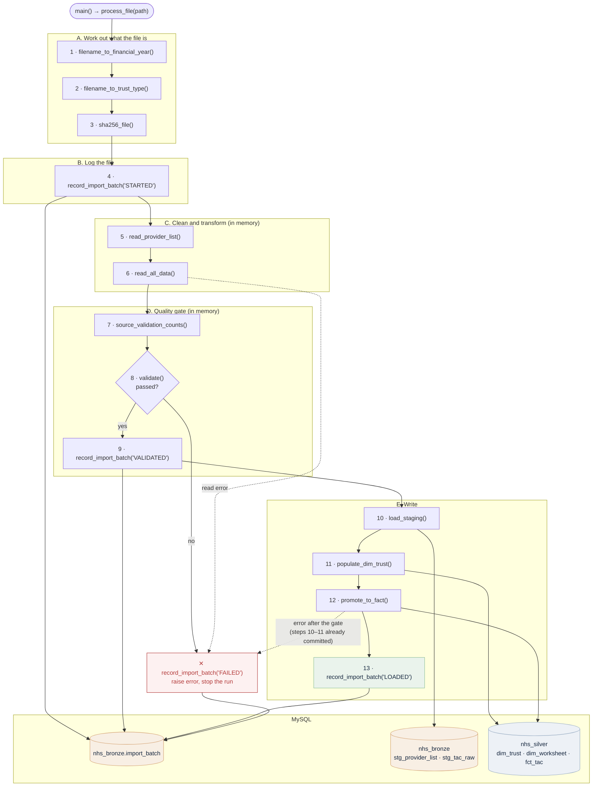

---
markmap:
  initialExpandLevel: 2
  colorFreezeLevel: 2
---

# Stage 3: Data Cleaning & Transformation

**Implementation:** Quality checks, source standardisation and conforming into Silver dimensions/facts.

> This stage turns six NHS England workbooks into data I can trust. It explains the problems the raw files
> had, how I fixed each one, and why I keep an untouched copy of the source before cleaning anything. The
> code for each step, and a real row before and after, follow further down.

---

## 3.1 What This Stage Does

The workbooks from [stage ②](../02_data_ingestion/README.md) are accurate, but they aren't ready to analyse.
Column names change between years. Every figure appears twice, once for the current year and once as the
prior-year comparison. The same trust can be spelled differently in different sheets. Some amounts carry
decimal places that are easy to lose.

This stage solves those problems once, in one place, so that every number used later in the analysis has
been checked on the way in. It also does something just as important: it **refuses to load a file it can't
trust**, rather than loading most of it and hoping for the best.

## 3.2 Three Layers, One Direction

I split the warehouse into three MySQL databases, each with one job. Data only ever moves forward:


This is the "medallion" pattern used widely in data engineering. I chose it because each layer answers a
different question:

- **Bronze — what did NHS England actually publish?** An untouched copy of every source row, including the
  prior-year comparisons and any blank amounts.
- **Silver — what are the cleaned facts?** Current-year figures only, each linked to its trust's ODS code,
  with no duplicates.
- **Gold — what does a finance team need to see?** Ready-made views of the financial statements and KPIs,
  one row per trust per year.

Keeping those questions apart means a problem in one layer can be found and fixed without disturbing the
others.

## 3.3 Why I Keep a Raw Copy Before Cleaning

The simplest design would clean the data in Python and write it straight into the final tables. I decided
against that, and the Bronze layer is the reason. It costs some disk space, and it gives me three things I
think are worth more.

**I can tell where an error came from.** If a figure in a report looks wrong, the first question is: did
NHS England publish it that way, or did my code change it? Bronze holds the exact source row behind every
fact, with its original trust name, its place on the original form, the file it came from and that file's
fingerprint. That question always has an answer, which is the same principle as treating the original
publication as the fixed reference point in [stage ①](../01_data_sourcing/README.md).

**I can prove the cleaning was right.** Cleaning removes things on purpose: the prior-year comparison
figures, and any amounts left blank. Silver doesn't keep them, so Silver alone can't show that the right
things were removed. Bronze can. For example, it shows that a blank amount and a genuine zero are kept
distinct. The source files contain a large number of real zeros, and treating them as "missing", or blanks
as zero, would quietly change the analysis.

**I can reload safely.** Each workbook owns its own slice of the data, one financial year for one type of
trust. If NHS England corrects a file, I reload just that file. Its slice is replaced in a single step, the
other five files are never touched, and if the reload fails the previous version stays in place.

## 3.4 The Problems I Had to Solve

**Column names changed between years.** NHS England renamed two columns after 2021/22. A small rename map
reads both versions the same way, so the pipeline doesn't need a special case for "the old files".

**Every figure appears twice.** Each workbook repeats the previous year's figures as a comparison column.
Loading three years of files without care would count most years twice. I tag every row as current year or
prior year, keep both in Bronze as evidence, and move only current-year figures into Silver.

**Trust names don't always match.** The financial data identifies trusts by name, but the stable identifier
is the three-character ODS code, which comes from a separate sheet. Names vary in capitals, punctuation and
"&" versus "and", so I match on a normalised version of the name. For the two trusts whose name in the
financial data differs from the provider list (for example "South Warwickshire *University* NHS Foundation
Trust"), I added a small, reviewed list of aliases. I deliberately avoided "fuzzy" matching: a near-miss could
silently attach one trust's finances to another, and that kind of error is very hard to spot later.

**Some amounts have decimals.** TAC reports in thousands of pounds, but some values carry up to five
decimal places. I store them at full precision rather than rounding to whole thousands.

## 3.5 A Gate, Not a Warning

Before anything is written, each file passes through a quality gate. It checks for rows that can't be
identified, duplicated rows, two source lines that would collide in the final table, and any trust name that
can't be matched to exactly one ODS code.

Every one of these checks stops the load. I chose that over warning and carrying on because in financial
reporting, a file that is mostly loaded is worse than one that isn't loaded at all: the totals look plausible
and are wrong. When a file is rejected, the reason is recorded in the database alongside the file's
fingerprint and row counts, so there is an audit trail for every load, successful or not.

---

## 3.6 How Python and SQL Work Together

The pipeline has two separate halves:

- **SQL builds the structure.** Before anything is loaded,
  [`create_tables_mysql.sql`](../../sql/schema/create_tables_mysql.sql) creates the three databases and
  every table in them, empty.
- **Python fills it.** This stage's code reads each workbook and writes rows into those tables.
- **Python never creates a table**, so the schema must be built first.
- **How the SQL side works** (the build command, every table definition and the Gold views) is explained in
  the **[SQL Guide](../sql_database_guide/README.md)**.

### 3.6.1 The tables this stage writes to

This stage writes only to `nhs_bronze`, into the three tables the schema script created there:

| SQL table | One row per | Written by (Python file → function) | Purpose |
|-------|-------------|-------------------------------------|---------|
| `import_batch` | Source file (by name and fingerprint) | [`load_tac_data.py`](../../python/ingestion/load_tac_data.py) → `record_import_batch()` | The audit log: which file was loaded, when, its row counts and gate results, and whether it succeeded |
| `stg_provider_list` | Trust in a workbook's "List of Providers" sheet | [`load_tac_data.py`](../../python/ingestion/load_tac_data.py) → `load_staging()` | The lookup that turns a trust name into its ODS code |
| `stg_tac_raw` | Line in a workbook's "All data" sheet | [`load_tac_data.py`](../../python/ingestion/load_tac_data.py) → `load_staging()` | The near-verbatim copy of every published figure, current and prior year |

The full `CREATE TABLE` for each is in the [SQL Guide, Bronze](../sql_database_guide/README.md#40-bronze-the-landing-tables).
Two things connect the Python code to those definitions:

- **The Python column names are the SQL column names.** `read_all_data()` renames the Excel headers to
  exactly the names in the `CREATE TABLE` (`organisation_name`, `row_num`, `total` ...). That is what lets
  `DataFrame.to_sql()` write a DataFrame straight into the table with no column mapping.
- **`financial_year` and `trust_type` are on every row.** Python adds them from the file name. Together
  they identify which of the six workbooks a row came from, so every `DELETE` the loader runs is filtered
  on them and a reload only ever touches its own file's rows.

### 3.6.2 How Python connects to MySQL

Python talks to MySQL through **SQLAlchemy** (a Python database toolkit), using the **PyMySQL** driver.
`get_engine()` builds the connection from environment variables, so no password is written in the code:

```python
DB_USER     = os.getenv("DB_USER", "root")
DB_PASSWORD = os.getenv("DB_PASSWORD")          # required; the script stops if it's not set
DB_HOST     = os.getenv("DB_HOST", "127.0.0.1")
DB_PORT     = int(os.getenv("DB_PORT", "3306"))

STG_DB    = "nhs_bronze"
SILVER_DB = "nhs_silver"

def get_engine(database: str):
    url = URL.create(
        drivername="mysql+pymysql",
        username=DB_USER, password=DB_PASSWORD,
        host=DB_HOST, port=DB_PORT,
        database=database,                       # which of the three databases to use
        query={"charset": "utf8mb4"},
    )
    return create_engine(url)
```

An engine connects to one database at a time. Each function asks for the one it writes to:
`get_engine(STG_DB)` for Bronze in this stage, and `get_engine(SILVER_DB)` for Silver in the next stage. Each
write runs inside `with engine.begin() as conn:`, which opens a **transaction**. If every statement in the
block succeeds, it is committed. If any one fails, all of them are rolled back, so the database is never
left half-updated.

### 3.6.3 The full flow for one workbook

`main()` finds every `tac_nhs_*.xlsx` file in `data/raw/` with `find_tac_files()` (skipping the illustrative workbook), sorts them
by name, and passes each one to `process_file()`. For each file, these functions run in this order. The
**Source** column shows which Python file each function lives in.

**A. Work out what the file is** (Python only)

| # | Function | Source | What it does | Writes to MySQL |
|---|----------|--------|--------------|-----------------|
| 1 | `filename_to_financial_year()` | [`load_tac_data.py`](../../python/ingestion/load_tac_data.py) | `…_2021_22.xlsx` → `2021/22` | — |
| 2 | `filename_to_trust_type()` | [`load_tac_data.py`](../../python/ingestion/load_tac_data.py) | `foundation` in the name → `FOUNDATION_TRUST`, otherwise `NHS_TRUST` | — |
| 3 | `sha256_file()` | [`source_integrity.py`](../../python/ingestion/source_integrity.py) | Fingerprints the file's bytes, e.g. `e70b6db7…` | — |

**B. Log the file**

| # | Function | Source | What it does | Writes to MySQL |
|---|----------|--------|--------------|-----------------|
| 4 | `record_import_batch("STARTED")` | [`load_tac_data.py`](../../python/ingestion/load_tac_data.py) | Logs the file before it is read | `nhs_bronze.import_batch` (upsert) |

**C. Clean and transform** (in memory, nothing written)

| # | Function | Source | What it does | Writes to MySQL |
|---|----------|--------|--------------|-----------------|
| 5 | `read_provider_list()` | [`load_tac_data.py`](../../python/ingestion/load_tac_data.py) | Renames and trims the provider list, adds the name key with `provider_name_key()` (from `source_integrity.py`), keeps only 3-character ODS codes | — |
| 6 | `read_all_data()` | [`load_tac_data.py`](../../python/ingestion/load_tac_data.py) | Finds the sheet with `find_sheet_name()`, renames headers, drops unidentifiable rows, tags CY/PY with `infer_year_type()`, converts amounts to 5 dp, adds the name key with `provider_name_key()` (from `source_integrity.py`) and the source columns | — |

**D. Quality gate** (in memory)

| # | Function | Source | What it does | Writes to MySQL |
|---|----------|--------|--------------|-----------------|
| 7 | `source_validation_counts()` | [`source_integrity.py`](../../python/ingestion/source_integrity.py) | Counts duplicates, fact-key collisions, ambiguous and unmatched names | — |
| 8 | `validate()` | [`load_tac_data.py`](../../python/ingestion/load_tac_data.py) | Pass, or raise an error (see ✕ below) | — |
| 9 | `record_import_batch("VALIDATED")` | [`load_tac_data.py`](../../python/ingestion/load_tac_data.py) | Saves the status and the gate's counts | `nhs_bronze.import_batch` (upsert) |

**E. Write**

| # | Function | Source | What it does | Writes to MySQL |
|---|----------|--------|--------------|-----------------|
| 10 | `load_staging()` | [`load_tac_data.py`](../../python/ingestion/load_tac_data.py) | Deletes this file's year/type slice, then inserts in batches | `nhs_bronze.stg_provider_list`, `nhs_bronze.stg_tac_raw` |
| 11 | `populate_dim_trust()` | [`load_tac_data.py`](../../python/ingestion/load_tac_data.py) | Adds new trusts, updates existing ones ([stage ④](../04_data_modelling_and_analytics/README.md#42-how-python-fills-silver-once-per-workbook)) | `nhs_silver.dim_trust` |
| 12 | `promote_to_fact()` | [`load_tac_data.py`](../../python/ingestion/load_tac_data.py) | Adds missing schedules, then replaces this file's facts in one transaction ([stage ④](../04_data_modelling_and_analytics/README.md#42-how-python-fills-silver-once-per-workbook)) | `nhs_silver.dim_worksheet`, `nhs_silver.fct_tac` |
| 13 | `record_import_batch("LOADED")` | [`load_tac_data.py`](../../python/ingestion/load_tac_data.py) | Sets `completed_ts`; the file is done | `nhs_bronze.import_batch` (upsert) |

**✕ On any error in steps 5–12:** `record_import_batch("FAILED", error)` saves the reason to
`nhs_bronze.import_batch`, the error is re-raised, and `main()` stops the whole run.

**Steps 1–3 and 5–8 never touch the database.** A file that fails the gate changes nothing except its
`FAILED` row in `import_batch`. A failure *after* the gate is different: steps 10 and 11 each commit their
own transaction, so if step 12 fails, the new Bronze rows and `dim_trust` updates stay, while `fct_tac`
rolls back to its previous state.




---

## 3.7 How It Works in the Code

The table above lists every step. This section shows the code behind steps 4 to 10, which take a workbook
from disk into Bronze. Steps 11 and 12 move it on into Silver and are covered in
[stage ④](../04_data_modelling_and_analytics/README.md#42-how-python-fills-silver-once-per-workbook).

### 3.7.1 Step 4 — Log the file before reading it

`record_import_batch("STARTED")` writes the file name, size, financial year, trust type and a SHA-256
fingerprint of the file's exact bytes to `nhs_bronze.import_batch`. The same row is updated as the file
moves through the steps (`VALIDATED` at step 9, `LOADED` at step 13), or marked `FAILED` with the error
message. The fingerprint from step 3 is also stamped on every row the file produces, so any figure can be
tied to the exact version of the workbook it came from.

### 3.7.2 Steps 5–6 — Read and standardise both sheets

Each workbook is read entirely in memory. Apart from the audit log entry, nothing is written to the
database until step 10.

**The provider list** (`read_provider_list()`) is the lookup that turns trust names into ODS codes. Its
columns are renamed to the warehouse's names, rows without a name or code are dropped, text is trimmed,
and only rows whose code is exactly three letters or digits are kept. That removes blank rows and notes
at the bottom of the sheet:

```python
# Rename the provider-list columns to the warehouse's names
df = df.rename(columns={
    "Full name of Provider": "organisation_name",
    "NHS code":              "org_code",
    "Region":                "region",
    "Sector":                "sector",
})

# Drop rows with no name or no code
df = df.dropna(subset=["org_code", "organisation_name"])

# Keep only real ODS codes: exactly three letters or digits
df = df[df["org_code"].str.fullmatch(r"[A-Za-z0-9]{3}", na=False)]
```

**The financial data** (`read_all_data()`) goes through five transformations:

*A. Read with explicit types,* so codes stay as text and amounts as numbers:

```python
# Find the sheet whatever its capitalisation ("All data" or "All Data")
sheet_name = find_sheet_name(path, "All data")

df = pd.read_excel(
    path,
    sheet_name=sheet_name,
    dtype={
        "OrganisationName": str,
        "WorkSheetName":    str,
        "TableID":          "Int64",   # whole number that allows blanks
        "MainCode":         str,
        "RowNumber":        "Int64",
        "SubCode":          str,
        "Total":            float,     # the amount, in £000s
    },
)
```

*B. Standardise column names* across template years (2021/22 used different headers):

```python
# 2021/22 header         →  standard header
df = df.rename(columns={
    "Organisation Name": "OrganisationName",
    "Value number":      "Total",
    "Value Number":      "Total",
})
```

*C. Drop only rows that can't be identified,* and trim text. A row is kept as long as its six identifying
fields are present. A blank **amount** is kept, because a blank and a zero mean different things:

```python
# A row must have all six identifying fields; a blank amount is allowed
df = df.dropna(subset=[
    "organisation_name",
    "worksheet_name",
    "table_id",
    "main_code",
    "row_num",
    "sub_code",
])

# Remove stray spaces (the same is done for worksheet, MainCode and SubCode)
df["organisation_name"] = df["organisation_name"].astype(str).str.strip()
```

*D. Tag each row as current year or prior year* from its MainCode (`A02CY01` versus `A02PY01`). Both are
kept:

```python
# "PY" if the MainCode contains "PY" (e.g. A02PY01), otherwise "CY" (e.g. A02CY01)
df["year_type"] = df["main_code"].apply(infer_year_type)
```

*E. Convert amounts and attach metadata.* Amounts are kept to the source's five decimal places. If any
value isn't a number at all, the whole file is rejected rather than silently turned into a blank. Each row
then gets its normalised trust-name key, source file, fingerprint, trust type and financial year:

```python
# Convert amounts to numbers; anything that isn't a number becomes NaN here...
numeric_total = pd.to_numeric(df["total"], errors="coerce")

# ...so stop if a value that was present failed to convert: don't guess
if (df["total"].notna() & numeric_total.isna()).any():
    raise ValueError("non-numeric Total values")

# Keep the source's five decimal places
df["total"] = numeric_total.round(5)

# Attach the matching key and where the row came from
df["provider_name_key"] = df["organisation_name"].map(provider_name_key)
df["source_file"]       = source_file
df["source_sha256"]     = source_sha256
df["trust_type"]        = trust_type        # from the file name
df["financial_year"]    = financial_year    # from the file name
```

**The trust-name key** (`provider_name_key()` in `source_integrity.py`) is how a name in the financial data
is matched to the provider list. It removes differences that don't change which trust is meant, then
applies the small reviewed alias list:

```python
def normalise_provider_name(value: str) -> str:
    # One standard form of each character, all lower case
    text = unicodedata.normalize("NFKC", str(value)).casefold()

    # "&" and "and" should match
    text = text.replace("&", " and ")

    # Curly and straight apostrophes should match
    text = text.replace("’", "'").replace("‘", "'")

    # Any run of punctuation or symbols becomes a single space
    text = re.sub(r"[^a-z0-9]+", " ", text)

    # Collapse repeated spaces and trim the ends
    return " ".join(text.split())
```

| Published name | Key used for matching |
|---|---|
| `Guy's & St Thomas' NHS Foundation Trust` | `guy s and st thomas nhs foundation trust` |
| `King’s College Hospital NHS Foundation Trust` | `king s college hospital nhs foundation trust` |
| `South Warwickshire University NHS Foundation Trust` | `south warwickshire nhs foundation trust` (via the alias list) |

### 3.7.3 Steps 7–9 — The quality gate

The gate is two functions. `source_validation_counts()` (step 7) counts each kind of problem, and
`validate()` (step 8) stops the load if any count is above zero. They are separate so the same counts can
go both to the gate and into `import_batch`. Both run on the in-memory data, before anything is written:

| Check | Why it stops the load |
|-------|--------|
| A row is missing an identifying field | The row can't be traced back to the source |
| Two rows share all six identifying fields | Duplication in the source must not be hidden by the load |
| Two current-year rows would land on the same fact key | They would collide in Silver, and one would overwrite the other |
| The provider list repeats a trust | The name lookup must be one-to-one |
| One normalised name matches more than one ODS code | The match is ambiguous |
| A current-year row with an amount matches no ODS code | Its figures would silently disappear at the join |

Every check is critical. If any fails, the whole file is rejected, nothing is written, and `import_batch`
records `FAILED` with the reason. If all pass, `import_batch` records `VALIDATED` along with the row counts
the gate calculated.

### 3.7.4 Step 10 — Write to Bronze: `load_staging()`

The validated data replaces this file's slice of Bronze, inside one transaction:

```python
scope = {"fy": financial_year, "tt": trust_type}

# One transaction: both tables are replaced together, or neither is
with engine.begin() as conn:

    # 1. Remove this file's previous slice (one financial year, one trust type)
    conn.execute(
        text("DELETE FROM stg_tac_raw WHERE financial_year = :fy AND trust_type = :tt"),
        scope,
    )
    conn.execute(
        text("DELETE FROM stg_provider_list WHERE financial_year = :fy AND trust_type = :tt"),
        scope,
    )

    # 2. Insert the validated data, in batches
    provider_df.to_sql(
        "stg_provider_list", conn,
        if_exists="append", index=False, chunksize=500,
    )
    data_df.to_sql(
        "stg_tac_raw", conn,
        if_exists="append", index=False, chunksize=2000,
    )
```

The delete is limited to one financial year and one trust type, so reloading a file never touches the
other five. Because both tables are in one transaction, a failed reload leaves the previous version in
place. `chunksize=2000` sends the rows in batches, because a single insert of up to a million rows would
exceed MySQL's maximum packet size.

## 3.8 The Output: Before and After

This is one real figure going through the stage: Airedale NHS Foundation Trust's patient care income in
the 2021/22 Foundation Trusts workbook.

**Before — the "All data" sheet** (the 2021/22 column headers):

| Organisation Name | WorkSheetName | TableID | MainCode | RowNumber | SubCode | Value number |
|---|---|---:|---|---:|---|---:|
| Airedale NHS Foundation Trust | TAC02 SoCI | 1 | A02CY01 | 12 | SCI0100A | 218,758.00 |
| Airedale NHS Foundation Trust | TAC02 SoCI | 1 | A02PY01 | 12 | SCI0100A | 196,771.00 |

**After — `nhs_bronze.stg_tac_raw`**, with standard column names and the columns this stage adds in bold:

| organisation_name | worksheet_name | main_code | row_num | sub_code | total | **year_type** | **provider_name_key** | **source_file** | **source_sha256** | **trust_type** | **financial_year** |
|---|---|---|---:|---|---:|---|---|---|---|---|---|
| Airedale NHS Foundation Trust | TAC02 SoCI | A02CY01 | 12 | SCI0100A | 218758.00000 | CY | airedale nhs foundation trust | tac_nhs_foundation_trusts_2021_22.xlsx | e70b6db7… | FOUNDATION_TRUST | 2021/22 |
| Airedale NHS Foundation Trust | TAC02 SoCI | A02PY01 | 12 | SCI0100A | 196771.00000 | PY | airedale nhs foundation trust | tac_nhs_foundation_trusts_2021_22.xlsx | e70b6db7… | FOUNDATION_TRUST | 2021/22 |

Both rows are kept: the current-year figure, and the prior-year comparison, which is the 2020/21
figure as shown in this workbook. Each now records which year it belongs to, how it will be matched to its ODS
code (`RCF`, from the provider list), and exactly which file it came from. In stage ④ only the `CY` row
moves on to Silver.

The full `stg_tac_raw` table definition, and why it has no unique key, is in the
[SQL Guide](../sql_database_guide/README.md#40-bronze-the-landing-tables).

---

## 3.9 Stage ③ Summary

| Concept | Design Decision | Why |
|---------|------------------|-----|
| Three databases | `nhs_bronze` evidence + `nhs_silver` conformed + `nhs_gold` views | Keeps what Silver leaves out, so loads can be traced, checked and safely reloaded |
| `float` dtype for `Total` | NaN-safe read, then round to five decimals | Preserves genuine fractional £000 amounts |
| CY/PY classification | Preserve both in Bronze; promote populated CY rows only | Retains source evidence while preventing double-counting in Silver |
| Validate before write | Every source-gate check is critical and halts the file | No partially trusted file ever lands |
| DELETE + INSERT in staging | Scoped to `(financial_year, trust_type)`, one transaction | Idempotent reloads without touching other files' rows |
| No unique key on `stg_tac_raw` | Bronze keeps every source row (CY, PY, blanks); `validate()` rejects duplicates before writing | Source evidence is kept; key integrity is enforced again in Silver |
| Normalised trust-name key, no fuzzy matching | `provider_name_key()` plus a short reviewed alias list | A near-miss match could attach one trust's figures to another |

---

## 3.10 Relevant Files

| File | What to Read |
|------|-------------|
| [python/ingestion/load_tac_data.py](../../python/ingestion/load_tac_data.py) | `process_file()`, `record_import_batch()`, `read_provider_list()`, `read_all_data()`, `validate()`, `load_staging()` |
| [python/ingestion/source_integrity.py](../../python/ingestion/source_integrity.py) | `provider_name_key()`, the alias list, the gate's counts |
| [SQL Guide](../sql_database_guide/README.md) | How the schema is built; the `stg_tac_raw`, `stg_provider_list` and `import_batch` definitions |
| [python/CLAUDE.md](../../python/CLAUDE.md) | Pandas patterns, environment-based connection configuration, validation pattern |
| [project_documentation.md](../../project_documentation.md), stage ③ | The narrative version, plus the client/server MySQL diagram |

---

*Previous: [Stage ② — Data Ingestion](../02_data_ingestion/README.md)*
*Next: [Stage ④ — Data Modelling & Analytics](../04_data_modelling_and_analytics/README.md)*
