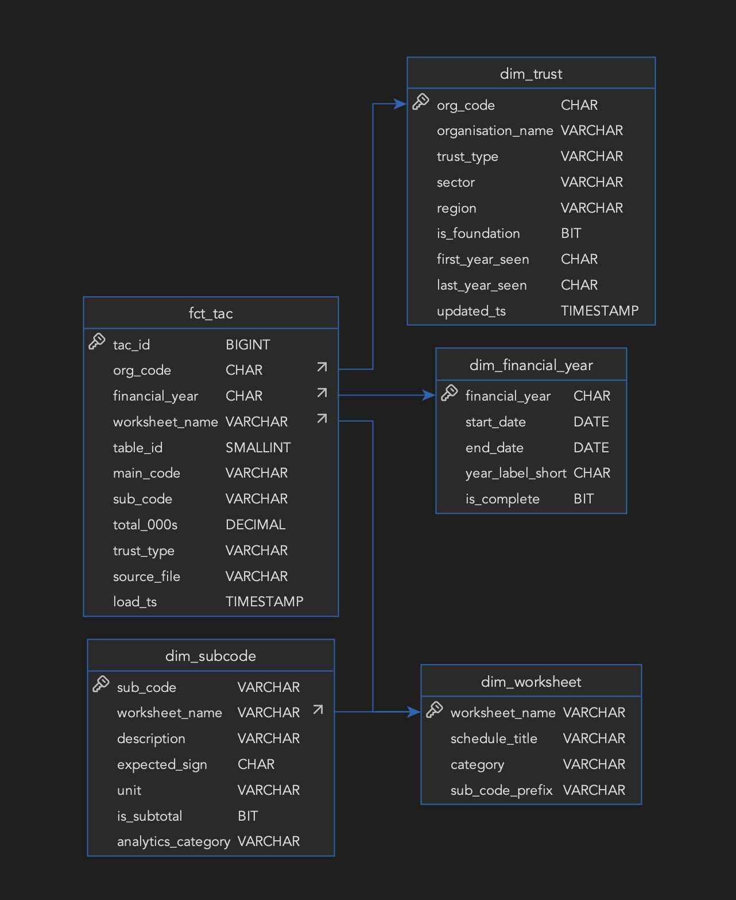

# Stage 4: Data Modelling & Analytics

**Implementation:** MySQL Silver star schema and Gold SQL reporting views / KPI calculations.

> `nhs_silver` — populated by the same script's `promote_to_fact()` and `populate_dim_trust()`. `nhs_gold`
> — nine SQL views pivoted on top of it. This is where raw, EAV-shaped staging data becomes a conformed
> star schema, and where KPI-ready output actually gets computed. Silver and Gold are separate databases
> (see [stage ③](../03-data-cleaning-and-transformation/README.md)), so every Gold view fully-qualifies its Silver source tables:
> `FROM nhs_silver.fct_tac`, `JOIN nhs_silver.dim_trust`, etc.

---

## Three-statement financial model

The analytical model now explicitly distinguishes the three NHS financial statements instead of treating income and expenditure as a complete sustainability assessment.

| Statement | Source worksheet | Gold view | Key measures |
| --- | --- | --- | --- |
| SoCI | `TAC02 SoCI` | [`v_profit_and_loss.sql`](../../sql/views/v_profit_and_loss.sql) | Operating surplus, net surplus, finance and comprehensive income |
| SoFP | `TAC03 SoFP` | [`v_balance_sheet.sql`](../../sql/views/v_balance_sheet.sql) | Assets, liabilities, cash, reserves and equity |
| SoCF | `TAC05 SoCF` | [`v_cash_flow.sql`](../../sql/views/v_cash_flow.sql) | Net operating (`SCF0180`), investing (`SCF0240`), financing (`SCF0315`) cash flows and closing cash (`SCF0355`) |

The Silver `fct_tac` remains long-form and source-code traceable. In the Gold layer, individual accounting statement views pivot the selected statement lines to one trust/year row. This is a pragmatic extension of the existing schema, not a claim that all proposed future dimension tables are implemented.

### Accounting reconciliation

[`v_statement_reconciliation.sql`](../../sql/views/v_statement_reconciliation.sql) exposes diagnostic residuals for:

- **SoCI:** Patient-care income + other operating income + signed operating expenses − operating surplus.
- **SoFP:** Total assets employed − total equity.
- **SoCF:** Operating + investing + financing net flows − net change in cash.
- **SoFP to SoCF:** Closing SoFP cash − closing SoCF cash.

A zero residual supports internal agreement **only if all required inputs and reporting definitions are correct**; null means unavailable and must not be silently treated as passing. Additional template-specific movements and accounting adjustments may have to be reconciled for opening/closing cash. These checks do **not** establish reconciliation to NHS England's national before-impairments-and-transfers performance measure.

### Deployment order and review

Run [`sql/schema/deploy_gold_views.sql`](../../sql/schema/deploy_gold_views.sql) from the repository root
with `mysql --commands -u root -p < sql/schema/deploy_gold_views.sql`. MySQL 9 disables client commands
such as `SOURCE` in batch mode unless `--commands` is supplied. The script applies every canonical view
in dependency order, ending with
`v_statement_reconciliation`. Check trust/year uniqueness and statement coverage before analysing
residuals. Cross-year comparisons and ratios require consistent denominators and confirmed sign
conventions.

The SQL views were executed against the freshly populated MySQL database for all 633 trust-years (first on
29 October 2026; a from-scratch rebuild on 21 November 2026 gave identical results). SoCI,
SoFP and SoCF residuals are within £1k; four SoFP-to-SoCF closing-cash exceptions exceed £1k, with a
maximum of £269.9941k.

**All four are bank overdrafts, not errors.** The SoFP reports cash gross, with overdrafts in borrowings;
the SoCF reports cash net of overdrafts (IAS 7). The `TAC19 CCE` cash note bridges the two, and each
residual equals the trust's overdraft (`CCE0140`) to within rounding:

| Provider/year exception | Closing-cash residual (£000) | Bank overdraft (£000) |
|---|---:|---:|
| Cambridge University Hospitals NHS Foundation Trust — 2021/22 | 134.65240 | −135 |
| Royal Cornwall Hospitals NHS Trust — 2022/23 | 3.00000 | −3 |
| Royal Cornwall Hospitals NHS Trust — 2023/24 | 5.00000 | −5 |
| Tees, Esk and Wear Valleys NHS Foundation Trust — 2023/24 | 269.99410 | −270 |

Adding the overdraft and committed-facility lines back leaves **no exception above £1k in any of the 633
trust-years**. The view does not yet apply that bridge, so the validation warning still appears; correcting
`cash_cross_statement_residual_000s` is a recorded follow-up. Full analysis, including a trap in the
cash note's two value columns: [financial reconciliation workpaper, section 4.1](../../reports/nhs_financial_reconciliation.md#41-closing-cash-exceptions-explained-by-bank-overdrafts).

---


## `populate_dim_trust()` — Slowly Changing Dimension, Type 1

`populate_dim_trust(financial_year, trust_type)` reads only the providers for the file currently loading,
then upserts them:

```sql
INSERT INTO dim_trust (org_code, organisation_name, trust_type, sector, region, is_foundation,
                        first_year_seen, last_year_seen)
VALUES (...)
ON DUPLICATE KEY UPDATE
    -- descriptive attributes: take the incoming value only if this year is the latest seen
    organisation_name = IF(VALUES(last_year_seen) >= COALESCE(last_year_seen, ''),
                           VALUES(organisation_name), organisation_name),
    trust_type        = IF(... same test ..., VALUES(trust_type), trust_type),
    is_foundation     = IF(... same test ..., VALUES(is_foundation), is_foundation),
    sector            = IF(... same test ..., COALESCE(VALUES(sector), sector), sector),
    region            = IF(... same test ..., COALESCE(VALUES(region), region), region),
    -- year range: only ever widens
    first_year_seen   = LEAST(COALESCE(first_year_seen, VALUES(first_year_seen)), VALUES(first_year_seen)),
    last_year_seen    = GREATEST(COALESCE(last_year_seen, VALUES(last_year_seen)), VALUES(last_year_seen)),
    updated_ts        = CURRENT_TIMESTAMP;
```

This overwrites rather than versions — a Type 1 SCD, not Type 2: one row per ODS code, showing the trust
as it was in the latest year it appears. Three things about it are deliberate:

- **It doesn't depend on load order.** Files load in filename order — all Foundation Trust years, then
  all NHS Trust years — not chronologically. `LEAST`/`GREATEST` mean the year range can only widen, and
  the "is this the latest year?" test means an older file can never overwrite newer details. Loading the
  six files in reverse gives an identical table.
- **Renamed trusts show their current name.** Three trusts were renamed under the same ODS code in this
  period — `RQX` Homerton University Hospital → Homerton Healthcare, `RH8` Royal Devon and Exeter → Royal
  Devon University Healthcare, `RBN` St Helens and Knowsley → Mersey and West Lancashire. NHS England also
  changes capitalisation between years ("Maidstone And Tunbridge Wells"); the latest spelling wins.
- **Order of assignments matters.** MySQL evaluates the `UPDATE` assignments left to right, and later ones
  see earlier updates, so every "is this the latest year?" test runs before `last_year_seen` itself moves.
  `COALESCE(VALUES(sector), sector)` keeps an existing value if a newer file has a blank.

Trusts that closed keep their final year: The Pennine Acute Hospitals and North West Boroughs end at
2021/22; Yeovil District Hospital and Northern Devon Healthcare end at 2022/23.

## `promote_to_fact()` — The Critical Join

**Step A — resolve `org_code` by joining staging against the provider list:**

```sql
SELECT p.org_code, r.*
FROM stg_tac_raw r
JOIN stg_provider_list p
    ON  r.provider_name_key = p.provider_name_key
   AND  r.financial_year    = p.financial_year
   AND  r.trust_type        = p.trust_type
WHERE r.financial_year = :fy AND r.trust_type = :tt
  AND r.year_type = 'CY'          -- PY comparison rows stay in Bronze only
  AND r.total IS NOT NULL         -- blank amounts stay in Bronze only; zeros are promoted
```

The deterministic `provider_name_key` normalises case, punctuation and whitespace, then applies two
reviewed historical aliases. It is still constrained to the same year and file type. Before any database
write, `validate()` now fails the file if a populated current-year row is unmatched or if one key maps to
multiple ODS codes, so the promotion join cannot silently lose source facts.

**Step B — a self-healing step most walkthroughs of this pipeline miss:** before the join runs, every
distinct `worksheet_name` present in this file's staging rows is guaranteed to exist in `dim_worksheet`:

```python
for ws_name in stg_sheets["worksheet_name"]:
    conn.execute(text("""
        INSERT IGNORE INTO dim_worksheet (worksheet_name, schedule_title, category)
        VALUES (:ws, :ws, 'OTHER')
    """), {"ws": ws_name})
```

The DDL seeds **28** worksheets with proper titles and categories (the original seeded 19). On the verified
load, four more were self-healed with a placeholder title and `category = 'OTHER'` — `TAC00 - IFRS 16
Transition`, `TAC10 Op leases`, `TAC10X IAS 17 comparatives` and `TAC23 Reval Res` — giving **32** rows.
**30** of them carry current-year facts; `TAC10X IAS 17 comparatives` and `TAC14X RoU Assets PY` are
comparative-only schedules with no CY rows. Rather than let the `worksheet_name → dim_worksheet` foreign
key on `fct_tac` reject a row the DDL author didn't happen to seed, `promote_to_fact()` self-heals the
dimension first, via `INSERT IGNORE` so it's a no-op if the row already exists. This is a defensive
pattern worth calling out on its own: a dimension table doesn't have to be perfectly pre-seeded to be safe
to enforce a foreign key against, provided the promotion step is prepared to extend it. Adding the four
placeholder schedules to the DDL seed, with real titles, is an open tidy-up; the self-heal stays as the
safety net for any schedule NHS England adds in a future year.

**Step C — atomically replace the current source scope, then UPSERT in chunks:**

```python
with silver_engine.begin() as conn:   # one transaction for the delete and every chunk
    conn.execute(text("DELETE FROM fct_tac WHERE financial_year = :fy AND trust_type = :tt"),
                 {"fy": financial_year, "tt": trust_type})
    for start in range(0, len(fact_df), 1000):
        chunk = fact_df.iloc[start: start + 1000]
        conn.execute(upsert_sql, chunk.to_dict(orient="records"))
```

```sql
INSERT INTO fct_tac (org_code, financial_year, worksheet_name, table_id,
                      main_code, sub_code, total_000s, trust_type, source_file, source_sha256)
VALUES (...)
ON DUPLICATE KEY UPDATE
    worksheet_name = VALUES(worksheet_name),
    table_id       = VALUES(table_id),
    total_000s     = VALUES(total_000s),
    source_file    = VALUES(source_file),
    source_sha256  = VALUES(source_sha256),
    load_ts        = CURRENT_TIMESTAMP;
```

Chunked because `to_sql()` — used for the simpler staging load — doesn't support
`ON DUPLICATE KEY UPDATE`; this uses parameterised SQL instead.

**Why scoped replacement plus UPSERT?** `fct_tac` accumulates all six files, so a table-wide truncate would
erase other years and trust types. An UPSERT alone, however, cannot remove stale facts that disappeared
from a corrected workbook. The pipeline therefore opens one transaction, deletes only the current
`(financial_year, trust_type)` scope, and inserts the freshly validated rows. The unique key remains a
second idempotency guard:

```sql
UNIQUE KEY uq_tac (org_code, financial_year, main_code, sub_code)
```

Running the pipeline twice against the same file leaves `fct_tac` and `dim_trust` with identical row
counts, while `source_sha256` records the exact workbook content used.

---

## The Star Schema

<p align="center">

</p>

`fct_tac` is the centre — one row per `(org_code, financial_year, main_code, sub_code)`. Three enforced
foreign keys: `org_code → dim_trust`, `financial_year → dim_financial_year`, `worksheet_name →
dim_worksheet`. `sub_code` stays deliberately unconstrained: even though `dim_subcode` now carries **1,000
rows** — every SubCode across the 27 worksheets of NHS England's illustrative TAC workbook, generated by
`python/ingestion/build_subcode_reference.py` from NHS England's own illustrative TAC workbook (see
[stage ①](../01-data-sourcing/README.md)) rather than the 59 hand-curated rows the project started with —
a direct FK from `fct_tac.sub_code` would still be one NHS England schema revision away from blocking a
load, so the design stays the same on principle: `dim_subcode` carries the FK into `dim_worksheet` instead,
so the schedule-level relationship is enforced one join away, on a table 2.21 million rows smaller.

```sql
CREATE TABLE fct_tac (
    tac_id          BIGINT        AUTO_INCREMENT PRIMARY KEY,
    org_code        CHAR(3)       NOT NULL,
    financial_year  CHAR(7)       NOT NULL,
    worksheet_name  VARCHAR(50)   NOT NULL,
    table_id        SMALLINT      NOT NULL,
    main_code       VARCHAR(20)   NOT NULL,
    sub_code        VARCHAR(20)   NOT NULL,
    total_000s      DECIMAL(18,5) NOT NULL,
    trust_type      VARCHAR(20)   NOT NULL,
    source_file     VARCHAR(200)  NOT NULL,
    source_sha256   CHAR(64)      NOT NULL,
    load_ts         TIMESTAMP     DEFAULT CURRENT_TIMESTAMP,
    UNIQUE KEY uq_tac (org_code, financial_year, main_code, sub_code),
    INDEX idx_fct_org_year  (org_code, financial_year),
    INDEX idx_fct_sub_code  (sub_code),
    INDEX idx_fct_worksheet (worksheet_name),
    INDEX idx_fct_year      (financial_year),
    FOREIGN KEY (org_code)       REFERENCES dim_trust(org_code),
    FOREIGN KEY (financial_year) REFERENCES dim_financial_year(financial_year),
    FOREIGN KEY (worksheet_name) REFERENCES dim_worksheet(worksheet_name)
) ENGINE=InnoDB;
```

The live database was missing the third FK for a period during development — the DDL script always
declared it, but the deployed table didn't have it. I checked for orphaned `worksheet_name` values first
(none), then added it directly with `ALTER TABLE ... ADD CONSTRAINT`. Full story, including the
`SHOW CREATE TABLE` verification, is in `PROJECT_DOCUMENTATION.md`, stage ④.

### `dim_subcode` — the dimension that drives every view

```sql
CREATE TABLE dim_subcode (
    sub_code            VARCHAR(20)  PRIMARY KEY,
    worksheet_name      VARCHAR(50)  NOT NULL,
    description         VARCHAR(300) NOT NULL,
    expected_sign       CHAR(3),
    unit                VARCHAR(10)  DEFAULT '£000',
    is_subtotal         TINYINT(1)   NOT NULL DEFAULT 0,
    analytics_category  VARCHAR(30),   -- PAY | NON_PAY | NON_PAY_EXCL_EBITDA | ...
    FOREIGN KEY (worksheet_name) REFERENCES dim_worksheet(worksheet_name)
) ENGINE=InnoDB;
```

`analytics_category` is what lets `v_expenditure_breakdown` (below) sum by category without hardcoding a
SubCode list — tag once in the dimension, every view benefits. `is_subtotal` flags summary rows (e.g. a
"total patient care income" line) so detail exports can exclude them and avoid double-counting.

---

## Analytics Layer — The Nine SQL Views

`fct_tac` is correct once loaded, but it still contains 2,210,974 individual SubCode rows — not something a
dashboard can chart. Nine `nhs_gold` views pivot it into trust-level, year-level tables — each
fully-qualifying its `nhs_silver` source tables, since Gold and Silver are separate databases.

**`v_income_expenditure`** — pivots TAC02 SoCI SubCodes into an I&E summary row per trust per year:

```sql
SELECT
    org_code, financial_year,
    MAX(CASE WHEN sub_code = 'SCI0100A' THEN total_000s END) AS patient_care_income_000s,
    MAX(CASE WHEN sub_code = 'SCI0140A' THEN total_000s END) AS operating_surplus_000s,
    MAX(CASE WHEN sub_code = 'SCI0240'  THEN total_000s END) AS net_surplus_000s
FROM fct_tac
WHERE worksheet_name = 'TAC02 SoCI'
GROUP BY org_code, financial_year;
```

**`v_expenditure_breakdown`** — pivots TAC08 using `dim_subcode.analytics_category`, not a hardcoded list:

```sql
SUM(CASE WHEN sc.analytics_category = 'PAY'     THEN f.total_000s END) AS pay_000s,
SUM(CASE WHEN sc.analytics_category = 'NON_PAY' THEN f.total_000s END) AS non_pay_000s
```

**`v_workforce`** — pivots TAC09 into staff cost and WTE columns.

**`v_kpis`** — joins the three views above, computes the derived metrics:

```sql
operating_surplus_000s + COALESCE(depreciation_amort_000s, 0)     AS ebitda_000s
ROUND(ebitda_000s / NULLIF(total_income_000s, 0) * 100, 1)        AS ebitda_margin_pct
ROUND(pay_000s / NULLIF(total_income_000s, 0) * 100, 1)           AS pay_pct_income
ROUND(staff_cost_000s / NULLIF(total_wte, 0), 1)                  AS cost_per_wte_000s
```

**`v_profit_and_loss`** — the full statutory Profit & Loss, additive to `v_income_expenditure` rather than
a replacement for it: all ~27 real TAC02 SoCI/SOC lines (operating result, finance income/costs, PDC
dividend, other comprehensive income), down to `total_comprehensive_income_000s`. Kept as a separate view
so `v_kpis` and `v_trust_annual_scorecard` — both built against `v_income_expenditure`'s narrower shape —
don't change shape underneath their existing dependents.

**`v_balance_sheet`** — the full statutory Balance Sheet: all 40 real TAC03 SoFP `BAL*` lines,
non-current/current assets and liabilities down to `total_equity_000s`. Unlike SoCI/EXP, TAC03 already
stores correctly-signed values in the raw data (liabilities negative), so the pivot needs no sign-flipping
— just `MAX(CASE WHEN sub_code = '...' THEN total_000s END)` as-is. TAC03 rows have always been sitting in
`fct_tac` (`promote_to_fact()` never filtered by worksheet), so this view is a pure additive job — no
ingestion change was needed to build it.

**`v_cash_flow`** — the statutory TAC05 SoCF summary: operating, investing and financing cash flows,
reported net cash movement, opening cash, closing cash and relevant transfer lines.

**`v_statement_reconciliation`** — a union-spine diagnostic view that retains a trust/year even if one
statement is absent. It exposes `has_soci`, `has_sofp`, `has_socf` and four nullable residuals; missing
inputs never become false zero passes.

**`v_trust_annual_scorecard`** — a wide, one-row-per-trust-per-year view combining `v_income_expenditure`,
`v_expenditure_breakdown`, `v_workforce`, and `v_kpis`, built for DirectQuery and ad-hoc SQL (see
`sql/analysis/`), not the CSV export — the export in [stage ⑤](../05-data-preparation-for-reporting/README.md) queries the
narrower views (including `v_profit_and_loss`/`v_balance_sheet`) separately instead.

---

## Stage ④ Summary

| Concept | Design Decision | Why |
|---------|------------------|-----|
| Scoped fact replacement plus UPSERT | Delete only the current `(financial_year, trust_type)` inside one transaction | Removes stale facts without touching the other five source scopes |
| Order-independent `dim_trust` upsert | Year range widens with `LEAST`/`GREATEST`; attributes from the latest year | Files don't load chronologically; renamed trusts show their current name |
| Self-healing `dim_worksheet` | `INSERT IGNORE` before the join | The FK must never block a row for an under-seeded dimension — now a safety net, not a crutch |
| No FK from `fct_tac` to `dim_subcode` | Even at 1,000 seeded rows, a future NHS England schema change could still add an unseeded code | Enforced one join away instead, on a much smaller table |
| `MAX(CASE WHEN sub_code = ... )` pivot idiom | Every `v_*` view, including `v_profit_and_loss`/`v_balance_sheet` | Turns EAV rows into named columns without changing the fact table |
| `analytics_category` on `dim_subcode` | Tag once, every view benefits | Avoids hardcoded SubCode lists inside view SQL |
| Gold views fully-qualify Silver tables | `FROM nhs_silver.fct_tac`, not bare `fct_tac` | `nhs_gold` and `nhs_silver` are separate databases |
| Reconciliation tolerance | Flag absolute residuals above £1k | Allows sub-£1k source rounding while retaining material exceptions |

---

## Relevant Files

| File | What to Read |
|------|-------------|
| [python/ingestion/load_tac_data.py](../../python/ingestion/load_tac_data.py) | `populate_dim_trust()`, `promote_to_fact()` |
| [sql/schema/create_tables_mysql.sql](../../sql/schema/create_tables_mysql.sql) | Full dimension + fact DDL |
| [sql/views/](../../sql/views/) | Standalone, canonical version of every `v_*` view |
| [sql/CLAUDE.md](../../sql/CLAUDE.md) | Naming conventions, view standards, query style |
| [PROJECT_DOCUMENTATION.md](../../PROJECT_DOCUMENTATION.md), stage ④ | The narrative version, the FK-fix story, the KPI write-ups, and the key findings |

---

*Previous: [Stage ③ — Data Cleaning & Transformation](../03-data-cleaning-and-transformation/README.md)*
*Next: [Stage ⑤ — Data Preparation for Reporting](../05-data-preparation-for-reporting/README.md)*
