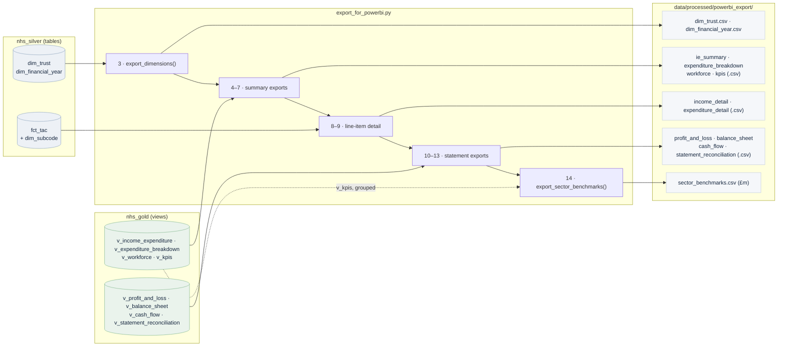

# Stage 5: Data Preparation for Reporting

**Implementation:** Export of curated Gold analytical views as CSVs for Power BI.

> This stage turns the live database into thirteen flat CSV files in `data/processed/powerbi_export/`, so
> any tool (Power BI, or a reviewer with no MySQL access) can use the results. One script does it:
> [`python/reporting/export_for_powerbi.py`](../../python/reporting/export_for_powerbi.py).

---

## How Python and SQL Work Together

This stage only reads from MySQL. Nothing is written back:

- **SQL holds the data.** The Gold views ([SQL Guide, Gold](../sql_database_guide/README.md#gold-the-views))
  do the pivoting and KPI maths, and the Silver tables hold the trusts, years and line items.
- **Python reads it and writes CSVs.** `export_for_powerbi.py` runs one `SELECT` per output file and saves
  each result to `data/processed/powerbi_export/`.
- **One connection, to `nhs_gold`.** `get_engine()` takes no database argument here; it always connects to
  `nhs_gold`, so views are named plainly (`FROM v_kpis`). The few queries that need Silver tables name the
  database too (`FROM nhs_silver.fct_tac`, `JOIN nhs_silver.dim_trust`).
- **Run it after the load.** The views read whatever is in Silver at that moment, so run this after
  [stage ③](../03_data_cleaning_and_transformation/README.md) and [stage ④](../04_data_modelling_and_analytics/README.md)
  have loaded all six workbooks.

### The full flow for one run

`main()` runs these steps in this order. Every function is in [`export_for_powerbi.py`](../../python/reporting/export_for_powerbi.py), and every CSV is written to
`data/processed/powerbi_export/`.

**A. Set up**

| # | Function | Source | What it does | Reads from MySQL | Writes CSV |
|---|----------|--------|--------------|------------------|------------|
| 1 | `main()` | [`export_for_powerbi.py`](../../python/reporting/export_for_powerbi.py) | Creates the output folder if it doesn't exist | — | — |
| 2 | `get_engine()` | [`export_for_powerbi.py`](../../python/reporting/export_for_powerbi.py) | Connects to `nhs_gold`; stops if `DB_PASSWORD` isn't set | — | — |

**B. Dimensions**

| # | Function | Source | What it does | Reads from MySQL | Writes CSV |
|---|----------|--------|--------------|------------------|------------|
| 3 | `export_dimensions()` | [`export_for_powerbi.py`](../../python/reporting/export_for_powerbi.py) | Exports the trust and year lookups | `nhs_silver.dim_trust`, `nhs_silver.dim_financial_year` | `dim_trust.csv`, `dim_financial_year.csv` |

**C. Summary views** (one row per trust per year)

| # | Function | Source | What it does | Reads from MySQL | Writes CSV |
|---|----------|--------|--------------|------------------|------------|
| 4 | `export_ie_summary()` | [`export_for_powerbi.py`](../../python/reporting/export_for_powerbi.py) | Income and expenditure summary | `v_income_expenditure` | `ie_summary.csv` |
| 5 | `export_expenditure_breakdown()` | [`export_for_powerbi.py`](../../python/reporting/export_for_powerbi.py) | Pay, non-pay and other cost groups | `v_expenditure_breakdown` | `expenditure_breakdown.csv` |
| 6 | `export_workforce()` | [`export_for_powerbi.py`](../../python/reporting/export_for_powerbi.py) | Staff costs and WTE | `v_workforce` | `workforce.csv` |
| 7 | `export_kpis()` | [`export_for_powerbi.py`](../../python/reporting/export_for_powerbi.py) | The four KPIs and their RAG flags | `v_kpis` | `kpis.csv` |

**D. Line-item detail** (one row per trust per year per SubCode)

| # | Function | Source | What it does | Reads from MySQL | Writes CSV |
|---|----------|--------|--------------|------------------|------------|
| 8 | `export_income_detail()` | [`export_for_powerbi.py`](../../python/reporting/export_for_powerbi.py) | Income line items, subtotals excluded | `nhs_silver.fct_tac` + `dim_trust` + `dim_subcode` (`TAC06`, `TAC07`) | `income_detail.csv` |
| 9 | `export_expenditure_detail()` | [`export_for_powerbi.py`](../../python/reporting/export_for_powerbi.py) | Expenditure line items, subtotals excluded | `nhs_silver.fct_tac` + `dim_trust` + `dim_subcode` (`TAC08`) | `expenditure_detail.csv` |

**E. Financial statements** (one row per trust per year)

| # | Function | Source | What it does | Reads from MySQL | Writes CSV |
|---|----------|--------|--------------|------------------|------------|
| 10 | `export_profit_and_loss()` | [`export_for_powerbi.py`](../../python/reporting/export_for_powerbi.py) | Full statutory P&L | `v_profit_and_loss` | `profit_and_loss.csv` |
| 11 | `export_balance_sheet()` | [`export_for_powerbi.py`](../../python/reporting/export_for_powerbi.py) | Full statutory balance sheet | `v_balance_sheet` | `balance_sheet.csv` |
| 12 | `export_cash_flow()` | [`export_for_powerbi.py`](../../python/reporting/export_for_powerbi.py) | Cash flows and closing cash | `v_cash_flow` | `cash_flow.csv` |
| 13 | `export_statement_reconciliation()` | [`export_for_powerbi.py`](../../python/reporting/export_for_powerbi.py) | Coverage flags and reconciliation residuals | `v_statement_reconciliation` | `statement_reconciliation.csv` |

**F. Benchmarks**

| # | Function | Source | What it does | Reads from MySQL | Writes CSV |
|---|----------|--------|--------------|------------------|------------|
| 14 | `export_sector_benchmarks()` | [`export_for_powerbi.py`](../../python/reporting/export_for_powerbi.py) | Totals and averages by year, sector and trust type, in **£m** | `v_kpis`, grouped | `sector_benchmarks.csv` |

**✕ If any step fails**, the error stops the run; the script has no error handling of its own. Files written
earlier in the run are already updated, and files from later steps keep whatever version they had before.
The folder then holds a mix of old and new files, so rerun the whole script after fixing the cause.



---

## How It Works in the Code

### Every step — one helper, `export_query()`

Steps 3 to 14 all funnel through a single function:

```python
def export_query(engine, sql: str, filename: str, **params) -> int:
    df = pd.read_sql(text(sql), engine.connect(), params=params if params else None)
    out_path = OUT_DIR / filename
    df.to_csv(out_path, index=False, encoding="utf-8-sig")  # utf-8-sig for Excel compat
    log.info("  Exported %d rows → %s", len(df), filename)
    return len(df)
```

Each `export_*()` function owns one SQL query and one output file (step 3 owns two of each), and all of
them hand it to `export_query()`, so the encoding and logging are set in one place.

### Every step — two details that shape every file

**The UTF-8 BOM.** `encoding="utf-8-sig"` on every `to_csv()` call prepends a byte-order mark. Without it,
Excel — and Power BI's CSV connector, which shares Excel's parser on Windows — misreads the `£` symbol in
column values. This bit me once during testing; it's now non-negotiable on every export in this file.

**`CAST(... AS DOUBLE)` in the SQL itself**, on every numeric column, rather than trusting pandas to
coerce MySQL's native `DECIMAL`:

```sql
SELECT
    org_code, organisation_name, sector, region, trust_type, financial_year,
    CAST(patient_care_income_000s AS DOUBLE) AS patient_care_income_000s,
    CAST(total_income_000s AS DOUBLE)         AS total_income_000s,
    CAST(operating_surplus_000s AS DOUBLE)    AS operating_surplus_000s,
    CAST(net_surplus_000s AS DOUBLE)          AS net_surplus_000s
FROM v_income_expenditure
ORDER BY financial_year, org_code
```

Reading an unwrapped `DECIMAL(18,5)` column back into pandas produces Python `Decimal` objects, which
write to CSV with inconsistent formatting. Casting to `DOUBLE` provides plain numeric values while
preserving the source's fractional £000 precision.

### Steps 8–9 — two files that don't come from a view

`export_income_detail()` and `export_expenditure_detail()` are the only two exports that query `fct_tac`
directly instead of a pre-aggregated `v_*` view — because a drilldown-by-line-item table is exactly the
one shape none of the summary views produce (including `v_profit_and_loss`/`v_balance_sheet`, which are
one row per trust per year, not one row per line item):

```sql
SELECT
    t.org_code, t.organisation_name, t.sector, t.trust_type,
    f.financial_year, f.sub_code,
    sc.description AS line_item, sc.analytics_category,
    CAST(f.total_000s AS DOUBLE) AS amount_000s
FROM nhs_silver.fct_tac f
JOIN nhs_silver.dim_trust   t  ON f.org_code = t.org_code
JOIN nhs_silver.dim_subcode sc ON f.sub_code = sc.sub_code
WHERE f.worksheet_name IN ('TAC06 Op Inc 1', 'TAC07 Op Inc 2')   -- income; TAC08 for expenditure
  AND f.main_code NOT LIKE '%PY%'
  AND sc.is_subtotal = 0                                         -- excludes summary rows
ORDER BY f.financial_year, t.org_code, f.sub_code
```

`sc.is_subtotal = 0` matters here specifically: without it, a Power BI visual summing this file would
double-count every trust's total alongside its own line items.

### Step 14 — one file that breaks the £000s convention on purpose

`export_sector_benchmarks()` pre-aggregates `v_kpis` by `(financial_year, sector, trust_type)` in SQL —
counts, sums, and averages across every trust in a sector — and divides its money columns by 1,000 in the
query itself, so the CSV lands in **£millions**, not £000s:

```sql
ROUND(SUM(total_income_000s) / 1000, 0) AS total_income_m,
```

This is the one deliberate exception to the £000s rule established back in [stage ①](../01_data_sourcing/README.md):
sector-level sums in £000s run to eight figures and stop being readable on a benchmarking chart axis.

---

## The Thirteen Files

The flow above shows where each file comes from. This is what one row of each file means:

| File | Step | Grain |
|------|-----:|-------|
| `dim_trust.csv` | 3 | One row per trust |
| `dim_financial_year.csv` | 3 | One row per financial year |
| `ie_summary.csv` | 4 | One row per trust per year |
| `expenditure_breakdown.csv` | 5 | One row per trust per year |
| `workforce.csv` | 6 | One row per trust per year |
| `kpis.csv` | 7 | One row per trust per year |
| `income_detail.csv` | 8 | One row per trust per year per income SubCode |
| `expenditure_detail.csv` | 9 | One row per trust per year per expenditure SubCode |
| `profit_and_loss.csv` | 10 | One row per trust per year: the full statutory P&L, about 27 lines pivoted into columns |
| `balance_sheet.csv` | 11 | One row per trust per year: the full statutory balance sheet, 40 `BAL*` lines pivoted into columns |
| `cash_flow.csv` | 12 | One row per trust per year: cash movements and closing cash |
| `statement_reconciliation.csv` | 13 | One row per trust per year: statement coverage and reconciliation residuals |
| `sector_benchmarks.csv` | 14 | One row per financial year per sector per trust type |

Full column-by-column schema for each file is in `project_documentation.md`, stage ⑤.

The enrichment script writes a separate nine-file set to `data/processed/transformed/`. This separation
is intentional: transformed KPI flags, income mix and year-on-year measures must not be overwritten by
the canonical Power BI export process.

---

## Stage ⑤ Summary

| Concept | Design Decision | Why |
|---------|------------------|-----|
| One `export_query()` helper | Every export funnels through it | One place to get encoding/logging right, once |
| `utf-8-sig` on every file | BOM-prefixed UTF-8 | Excel/Power BI's CSV connector misreads `£` without it |
| `CAST(... AS DOUBLE)` on numeric columns | Done in SQL, not pandas | Preserves fractional £000 values and avoids `Decimal` formatting noise |
| Two detail exports query `fct_tac` directly | No summary view produces line-item grain | `is_subtotal = 0` prevents double-counting on import |
| `sector_benchmarks.csv` is in £m, not £000s | Divided by 1,000 in the SQL | Sector-level £000s sums are unreadable on a chart axis |
| Separate `transformed/` output | Enrichment never writes over `powerbi_export/` | Prevents script order from silently changing reporting schemas |

---

## Relevant Files

| File | What to Read |
|------|-------------|
| [python/reporting/export_for_powerbi.py](../../python/reporting/export_for_powerbi.py) | Full script — `main()`, `get_engine()`, `export_query()` and the twelve `export_*()` functions |
| [SQL Guide](../sql_database_guide/README.md) | The Gold views and Silver tables this stage reads |
| [project_documentation.md](../../project_documentation.md), stage ⑤ | The narrative version, plus the full per-file column schema and the Power BI model diagram |

---

*Previous: [Stage ④ — Data Modelling & Analytics](../04_data_modelling_and_analytics/README.md)*
*Next: [Stage ⑥ — Data Visualisation & Insights](../06_data_visualisation_and_insights/README.md)*
