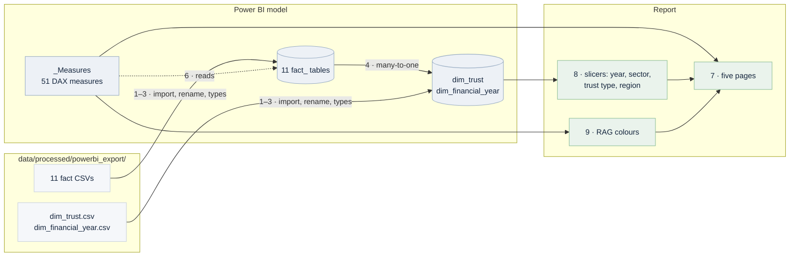

# Stage 6: Data Visualisation & Insights

**Implementation:** Power BI semantic model, DAX and proposed report pages (publication pending).

> This stage turns the thirteen CSVs from [stage ⑤](../05_data_preparation_for_reporting/README.md) into a
> Power BI model, 51 DAX measures and five report pages. It's the only stage a non-technical user (a finance
> director, a board) actually sees. No `.pbix` is checked in and the report isn't published yet, so the
> pages below are a specification, not screenshots of a finished report.

---

## How Power BI Connects to the Data

There is no script in this stage. It's built by hand in Power BI Desktop:

- **Power BI reads the CSVs.** It imports the files [`export_for_powerbi.py`](../../python/reporting/export_for_powerbi.py) writes to `data/processed/powerbi_export/`. It
  never writes back to them or to MySQL.
- **The model is built by hand.** Tables, relationships, measures and pages are created in Power BI
  Desktop, following [`setup_guide.md`](../../power_bi/setup_guide.md).
- **What's in the repo is the definition, not the file.** The measures are saved as [`_Measures.tmdl`](../../power_bi/dax/_Measures.tmdl) (exported from
  Power BI) and [`dax_measures.md`](../../power_bi/dax_measures.md) (readable copy). The setup guide holds the
  import steps, relationships and page specs.
- **Run it after stage 5.** Refreshing the report re-reads the CSVs, so it shows whatever the last export
  wrote.

### The full build, step by step

These are the steps in Power BI Desktop, in order. The **Source** column shows the repo file that defines
each one.

**A. Import**

| # | Action in Power BI Desktop | Source | What it does |
|---|----------------------------|--------|--------------|
| 1 | **Get Data → Text/CSV** | [`setup_guide.md`](../../power_bi/setup_guide.md) §1 | Loads each of the thirteen CSVs |
| 2 | Rename in the **Fields** pane | [`setup_guide.md`](../../power_bi/setup_guide.md) §1 | `ie_summary` → `fact_ie_summary`, and so on |
| 3 | **Transform Data** | [`setup_guide.md`](../../power_bi/setup_guide.md) §1 | Sets column types: codes and years as Text, `_000s` and `_pct` as Decimal Number |

**B. Model**

| # | Action in Power BI Desktop | Source | What it does |
|---|----------------------------|--------|--------------|
| 4 | **Model view → relationships** | [`setup_guide.md`](../../power_bi/setup_guide.md) §2 | Joins every fact table to `dim_trust` and `dim_financial_year`, many-to-one |
| 5 | **Enter Data → blank table** | [`setup_guide.md`](../../power_bi/setup_guide.md) §3 | Creates `_Measures`, an empty table that only holds measures |

**C. Measures**

| # | Action in Power BI Desktop | Source | What it does |
|---|----------------------------|--------|--------------|
| 6 | Add measures to `_Measures` | [`_Measures.tmdl`](../../power_bi/dax/_Measures.tmdl) | Adds the 51 DAX measures, in seven families |

**D. Report**

| # | Action in Power BI Desktop | Source | What it does |
|---|----------------------------|--------|--------------|
| 7 | Build the report pages | [`setup_guide.md`](../../power_bi/setup_guide.md) §4 | Five pages, visual by visual |
| 8 | Add slicers | [`setup_guide.md`](../../power_bi/setup_guide.md) §6 | Year, sector, trust type and region on every page |
| 9 | Apply RAG conditional formatting | [`setup_guide.md`](../../power_bi/setup_guide.md) §5 | Colours from the `... RAG Colour` measures |



---

## How It Works in the Model

### Steps 1–3 — Import and rename

Each CSV is imported via **Get Data → Text/CSV** (step 1) and renamed to the `fact_`/`dim_` prefix
convention (step 2), which is what Power BI's own model view then displays:

| CSV | Imported as |
|-----|---------------|
| `dim_trust.csv` | `dim_trust` |
| `dim_financial_year.csv` | `dim_financial_year` |
| `ie_summary.csv` | `fact_ie_summary` |
| `expenditure_breakdown.csv` | `fact_expenditure_breakdown` |
| `workforce.csv` | `fact_workforce` |
| `kpis.csv` | `fact_kpis` |
| `income_detail.csv` | `fact_income_detail` |
| `expenditure_detail.csv` | `fact_expenditure_detail` |
| `profit_and_loss.csv` | `fact_profit_and_loss` |
| `balance_sheet.csv` | `fact_balance_sheet` |
| `cash_flow.csv` | `fact_cash_flow` |
| `statement_reconciliation.csv` | `fact_statement_reconciliation` |
| `sector_benchmarks.csv` | `fact_sector_benchmarks` |

Step 3 checks the column types in **Transform Data**: `financial_year` and `org_code` as Text, and every
`_000s` and `_pct` column as Decimal Number, because the source holds genuine fractional £000 values.

`fact_profit_and_loss`, `fact_balance_sheet` and `fact_cash_flow` expose the three principal statements.
`fact_statement_reconciliation` supplies statement-coverage flags and diagnostic residuals. No published
report page consumes these newer tables yet; until that work is completed they are available for ad-hoc
visuals, reconciliation review and drillthrough. `cash_cross_statement_residual_000s` already adds bank
overdrafts back (the balance sheet shows cash gross, the cash-flow statement net);
`cash_overdrafts_000s` shows that adjustment for any trust-year with an overdraft.

### Step 4 — Model relationships

Every fact table joins to the two dimensions on `org_code` and/or `financial_year`, single-direction,
many-to-one — with one deliberate exception:

```text
fact_ie_summary[org_code / financial_year]              → dim_trust / dim_financial_year
fact_expenditure_breakdown[org_code / financial_year]    → dim_trust / dim_financial_year
fact_workforce[org_code / financial_year]                → dim_trust / dim_financial_year
fact_kpis[org_code / financial_year]                     → dim_trust / dim_financial_year
fact_income_detail[org_code / financial_year]            → dim_trust / dim_financial_year
fact_expenditure_detail[org_code / financial_year]       → dim_trust / dim_financial_year
fact_profit_and_loss[org_code / financial_year]          → dim_trust / dim_financial_year
fact_balance_sheet[org_code / financial_year]            → dim_trust / dim_financial_year
fact_cash_flow[org_code / financial_year]                 → dim_trust / dim_financial_year
fact_statement_reconciliation[org_code / financial_year] → dim_trust / dim_financial_year
fact_sector_benchmarks[financial_year]                   → dim_financial_year   (no dim_trust — see below)
```

`fact_sector_benchmarks` has no relationship to `dim_trust`: it was built pre-aggregated by
`(sector, trust_type)` in [stage ⑤](../05_data_preparation_for_reporting/README.md)'s SQL, so it has no `org_code` column to join
on — `sector` and `trust_type` stay unmodelled attributes on the table itself. The resulting eleven-fact star
diagram, re-exported from Power BI's own model view, is in `project_documentation.md`, stage ⑤.
`_Measures` (step 5) has no relationships at all.

### Steps 5–6 — DAX measures: 51 in one table

Step 5 creates **`_Measures`** with *Enter Data → blank table*. It holds no data, only measures, so they
have a home not tied to any one fact table. Step 6 adds the measures. Every one of the 51 lives in
`_Measures`, never inside a fact table, and never as an implicit
measure dragged straight off a column. Three real patterns cover almost all of them:

```dax
-- £000s → £m conversion (every base financial measure)
Total Income (£m) =
DIVIDE(SUMX(fact_ie_summary, fact_ie_summary[total_income_000s]), 1000, 0)

-- Ratio / percentage measure
EBITDA Margin % =
DIVIDE(
    SUMX(fact_kpis, fact_kpis[ebitda_000s]),
    SUMX(fact_kpis, fact_kpis[total_income_000s]),
    BLANK()
) * 100

-- Year-on-year: resolve the prior year via a lookup SWITCH, then re-evaluate a base measure against it
Prior Year =
VAR _current = SELECTEDVALUE(dim_financial_year[financial_year])
RETURN SWITCH(_current, "2023/24", "2022/23", "2022/23", "2021/22", "2021/22", "2020/21", BLANK())

Prior Year Income (£m) =
VAR _py = [Prior Year]
RETURN IF(NOT ISBLANK(_py), CALCULATE([Total Income (£m)], dim_financial_year[financial_year] = _py), BLANK())
```

RAG status measures return a string (`"Green"` / `"Amber"` / `"Red"` / `"Grey"`), and a matching
`... RAG Colour` measure maps that string to a verified hex code for conditional formatting:

```dax
EBITDA RAG =
VAR _margin = [EBITDA Margin %]
RETURN SWITCH(TRUE(), ISBLANK(_margin), "Grey", _margin >= 5, "Green", _margin >= 2, "Amber", "Red")

EBITDA RAG Colour =
SWITCH([EBITDA RAG], "Green", "#009639", "Amber", "#FFB81C", "Red", "#DA291C", "#E8EDEE")
```

The 51 measures split into seven families: Core I&E, KPIs, Workforce, Year-on-Year, RAG Status, Sector
Benchmark, and Dynamic Titles/Labels (slicer-aware page titles like `Page Title - I&E`, built with
`SELECTEDVALUE(..., "All Years")` so a page title updates live as filters change).

Two versions of every measure exist, and only one is authoritative if they ever disagree:

- **`power_bi/dax_measures.md`** — human-readable, grouped by family, meant to be read
- **`power_bi/dax/_Measures.tmdl`** — the exact `createOrReplace` export from Power BI Desktop's TMDL
  view, including format strings and lineage tags — **this file wins** on any disagreement

**A new financial year needs a DAX change.** `Prior Year` maps each year to the one before it by name, and
only knows 2023/24, 2022/23 and 2021/22. A 2024/25 load also needs `"2024/25", "2023/24"` adding to that
`SWITCH`, or every year-on-year measure is blank for the new year. This is on top of adding the year to
`dim_financial_year` in the [SQL Guide](../sql_database_guide/README.md#silver-the-star-schema).

### Step 7 — Report pages (specified, publication pending)

Full visual-by-visual specifications are in [power_bi/setup_guide.md](../../power_bi/setup_guide.md).

| Page | Purpose |
|------|---------|
| Executive Summary | KPI cards, sector breakdown, deficit/surplus donut, 3-year trend lines |
| Income & Expenditure | Waterfall bridge, trust-level matrix, scatter plots |
| Expenditure Detail | Pay vs non-pay breakdown, drugs costs, clinical negligence trend |
| Benchmarking | EBITDA distribution, top/bottom performers, peer comparison table |
| Workforce | WTE trends, cost per WTE, staff cost as % of income |

### Step 8 — Slicers on every page

Four slicers go on every page and filter all of that page's visuals at once: `dim_financial_year[financial_year]`
(single-select), `dim_trust[sector]`, `dim_trust[trust_type]` and `dim_trust[region]`.

### Step 9 — The RAG palette

Read directly out of the `*RAG Colour` measures, not approximated — these four values are the only ones
used for anything tied to a RAG status, through conditional formatting:

```text
Green (sustainable): #009639     Amber (at risk): #FFB81C
Red (unsustainable):  #DA291C     Grey (no data):  #E8EDEE
```

---

## Stage ⑥ Summary

| Concept | Design Decision | Why |
|---------|------------------|-----|
| `_Measures` as a blank table | Not a data table — holds only measures | Measures don't belong to one fact table any more than a KPI does |
| `fact_`/`dim_` rename on import | Matches SQL and DAX naming | One convention across the whole stack, not just inside MySQL |
| `fact_sector_benchmarks` has no `dim_trust` relationship | It's pre-aggregated by sector in SQL | There's no `org_code` column left to join on |
| `.tmdl` wins over `.md` on disagreement | `.tmdl` is a machine export, `.md` is hand-maintained | The hand-maintained copy is the one that can drift |
| RAG colours read from DAX, not approximated | Four fixed hex values | Consistency across every visual using RAG status |

---

## Relevant Files

| File | What to Read |
|------|-------------|
| [power_bi/setup_guide.md](../../power_bi/setup_guide.md) | Steps 1–5 and 7–9: import, relationships, page-by-page visual specs, palette, slicers |
| [power_bi/dax_measures.md](../../power_bi/dax_measures.md) | All 51 measures, grouped by family, human-readable |
| [power_bi/dax/_Measures.tmdl](../../power_bi/dax/_Measures.tmdl) | The authoritative, machine-exported measure definitions |
| [power_bi/CLAUDE.md](../../power_bi/CLAUDE.md) | Naming conventions, standard measure patterns, visual standards |
| [project_documentation.md](../../project_documentation.md), stage ⑥ | The narrative version |

---

*Previous: [Stage ⑤ — Data Preparation for Reporting](../05_data_preparation_for_reporting/README.md)*
